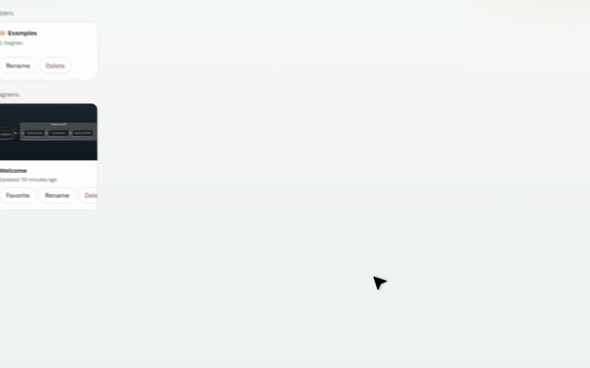
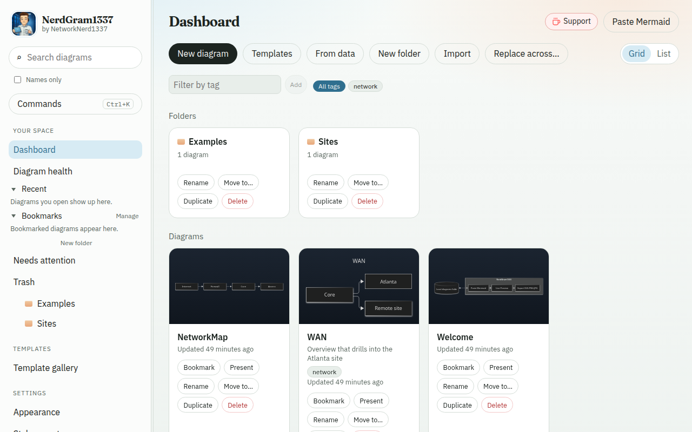

# NerdGram1337

[](https://ko-fi.com/networknerd1337)

NerdGram1337 is a local, code-first app for network diagrams in [Mermaid](https://mermaid.js.org/). Generate a diagram from CSV, JSON, network JSON, or CDP and LLDP text you already have, keep hand edits outside the generated block, and export **SVG**, **PNG**, **JPG**, or **PDF**. It is [MIT](LICENSE) licensed, © Ryan Thomas Huff. You edit a diagram, preview it live, and keep it as a real `.mmd` file on disk. Exports use the diagram theme and background. JPG and PDF are exports from the browser. The API and the CLI render SVG or PNG. There is no account, no hosted service, no AI generation, and no paywall. Optional GitHub sync can copy those diagrams to a private repository you own.

The **client** is a React app: the dashboard, the paste page, and the split editor. The **server** is an Express API that reads and writes the files. In development they run side by side. A production build, including the Docker image, serves the built client and the API from one process.

You start with sample diagrams: `Welcome.mmd`, `NetworkMap.mmd`, `Examples/Sequence.mmd`, and a linked pair, `WAN.mmd` and `Sites/Atlanta.mmd`. Anything you create is another file in that same folder.




The full-quality recording is [screenshots/nerdgram1337_dashboard_editor_demo.mp4](screenshots/nerdgram1337_dashboard_editor_demo.mp4).

## Support the project

NerdGram1337 is free and open source, built and maintained by NetworkNerd1337. If the app is useful to you, a donation on [Ko-fi](https://ko-fi.com/networknerd1337) helps support continued development and feature prioritization. A star on this repository, and an issue when something breaks, really help as well. NerdGram1337 is a gift to the open-source community, and I am committed to keeping it free.

The same page is in the app. **Support** is in the header on the dashboard, the paste page, the editor, and the other screens. It opens Ko-fi in a new tab and is hidden while a diagram is presented. **About** in the top-right header, next to **Support**, and **About NerdGram1337** in the command palette, open a dialog with the running version, the author, help links, the MIT license, and a **Support on Ko-fi** button. Nothing donation-related opens on its own.

## Questions and ideas

Questions and ideas go to [Discussions](https://github.com/NetworkNerd1337/NerdGram1337/discussions). A bug or a feature request uses the forms on the [issue page](https://github.com/NetworkNerd1337/NerdGram1337/issues/new/choose). A vulnerability is reported in private, as [SECURITY.md](SECURITY.md) describes.

## Quick start

Run NerdGram with Docker, or with Node.js on the machine. Docker is the install to use when you want the app. Node.js is how you develop it, and it is also a full install when you do not want Docker. Use one of them at a time. Development and production both want port **8787**.

The full install is in [Install](docs/install.md).

### Docker

The command uses `v2.1.0`, the tag for this tree (the same pin as [`compose.yaml`](compose.yaml)).

```bash
docker pull ghcr.io/networknerd1337/nerdgram1337:v2.1.0
```

```bash
docker run -d \
  --name nerdgram1337 \
  --restart unless-stopped \
  -p 127.0.0.1:8787:8787 \
  -e NERDGRAM_DATA_DIR=/data \
  -e NERDGRAM_INSTALL=docker \
  -v nerdgram-data:/data \
  ghcr.io/networknerd1337/nerdgram1337:v2.1.0
```

Open [http://127.0.0.1:8787](http://127.0.0.1:8787) or [http://localhost:8787](http://localhost:8787).

Compose, a local image build, and the rest of the Docker install are in [Install](docs/install.md#docker). A proxy that re-signs HTTPS is [Corporate TLS inspection](docs/troubleshooting.md#corporate-tls-inspection).

### Install the CLI from npm

The package name on npm is `nerdgram1337`. The command it installs is `nerdgram`. Node.js 20 or newer and npm 10 or newer are the same versions [the app uses](docs/install.md#nodejs).

```bash
npm install -g nerdgram1337
```

```bash
npx nerdgram1337 --help
```

`npm install -g` puts `nerdgram` on your `PATH`. `npx` runs the command without a global install. The package is public. Point `NERDGRAM_URL` at the running app. The default is `http://127.0.0.1:8787`, which is right when the app is on the same computer. npm 11 can warn that Puppeteer's postinstall is not covered by `allowScripts`. Chrome still installs. See [Command-line tool](docs/cli.md#install).

The full command list is in [the command-line tool](docs/cli.md).

### Node.js

```bash
git clone https://github.com/NetworkNerd1337/NerdGram1337.git
cd NerdGram1337
```

```bash
npm run install:all
```

```bash
npm run dev
```

Use [http://localhost:5173](http://localhost:5173).

The full Node.js steps are in [Install](docs/install.md#nodejs).

## Features

The dashboard lists folders and diagrams in a tree, with search and grid or list view.

- **[Preview](docs/features.md#preview).** Drag the preview to pan, and use the wheel to zoom toward the pointer. **Fit** resets that view.
- **[Editing](docs/features.md#editing).** Opening a diagram takes a lock for that browser tab.
- **[Files](docs/features.md#files).** **Your space** lists Recent, Bookmarks, and Needs attention, then Trash, then a Folders heading and the folder tree. Drag the edge of the sidebar to widen it. **Move to…** is on every diagram and folder, next to Rename and Delete.
- **[Trash and history](docs/features.md#trash-and-history).** Delete moves a diagram or a folder into the trash. The confirm follows the theme. Compare stays on screen, and side-by-side and text mark what changed.
- **[Titles, themes, and notes](docs/features.md#titles-themes-and-notes).** A diagram can start with [Mermaid's YAML front matter](https://mermaid.js.org/config/configuration.html). Cards show the file name, and a different title on a second line.
- **[Style presets](docs/features.md#style-presets).** Save a diagram's theme, colors, and font as a named preset, and copy it onto another diagram or a new one.
- **[Appearance](docs/features.md#appearance).** Light, Dark, or Match system. The choice stays in this browser. It does not change a diagram's theme.
- **[Diagram checks](docs/features.md#diagram-checks).** The code pane checks the diagram while you type. Mute warnings for one diagram from the editor. Errors stay. A link to a subgraph id is not reported as a typo.
- **[Linked diagrams](docs/features.md#linked-diagrams).** A node can open another diagram.
- **[Generate from data](docs/generate-from-data.md).** A CSV, JSON, network JSON, CDP, LLDP, or Cisco `show ip route` paste can build the diagram.
- **[Translators](docs/translators.md).** `nerdgram convert` turns a saved export into network JSON. It does not log in or call out.
- **[Design exports](docs/exports.md).** **Export as** can write a pyATS testbed, a containerlab or CML or GNS3 or EVE-NG lab, or an Ansible or Nornir inventory. Passwords and images are placeholders. NerdGram does not connect.
- **[Thumbnails, find, and shortcuts](docs/features.md#thumbnails-find-and-shortcuts).** Dashboard cards keep a thumbnail of each diagram.
- **[Search](docs/features.md#search).** The sidebar search box matches file names and paths, titles, tags, descriptions, notes, and the visible text in a diagram: node and edge labels, subgraph titles, sequence messages, and similar labels.
- **[Presentation](docs/features.md#presentation).** **Present** shows the diagram on its own, using the theme, look, and layout stored in the file.
- **[Template gallery](docs/features.md#template-gallery).** Templates are grouped by category. **Create as template** saves the open diagram under User created.
- **[GitHub sync](docs/github-sync.md).** GitHub sync is optional.
- **[In-app updates](docs/upgrading.md#in-app-updates).** The running version is the **About** button in the top-right header, next to **Support**, and **About NerdGram1337** in the command palette.
- **[Syntax reference](docs/features.md#syntax-reference).** NerdGram1337 ships a local mirror of the Mermaid diagram syntax docs. **Open Syntax Reference Library** opens it in a new tab.
- **[MCP server](docs/mcp.md).** An MCP client can list, read, lint, render, and update diagrams.

## Documentation

- **[Documentation index](docs/README.md).** Guides for installing NerdGram1337, using it, and working on it.
- **[FAQ](docs/faq.md).** Short answers, with a link to the page that has the detail.
- **[Security policy](SECURITY.md).** How to report a vulnerability in private.
- **[Install](docs/install.md).** Run NerdGram with Docker, or with Node.js on the machine.
- **[Features](docs/features.md).** The dashboard lists folders and diagrams in a tree, with search and grid or list view.
- **[Generate from data](docs/generate-from-data.md).** A CSV, JSON, network JSON, CDP, LLDP, or Cisco `show ip route` paste can build the diagram.
- **[Translators](docs/translators.md).** A saved export becomes network JSON. The command does not log in.
- **[Design exports](docs/exports.md).** A diagram and its network JSON can be written as a pyATS testbed, a lab file, or an inventory. Credentials are placeholders.
- **[Schema compatibility](docs/schema/README.md).** Network JSON stays on schemaVersion 1 when a change only adds optional fields, and moves to 2 when a field's meaning changes.
- **[GitHub sync](docs/github-sync.md).** GitHub sync is optional.
- **[Configuration](docs/configuration.md).** Set a variable in the same terminal before `npm run dev` or `npm start`, so the process inherits it.
- **[Team use](docs/team-use.md).** NerdGram has no accounts and no roles.
- **[Automation API](docs/api.md).** `/api/v1` is for scripts, CI, and other tools.
- **[MCP server](docs/mcp.md).** An MCP client can list, read, lint, render, and update diagrams. `/mcp` is streamable HTTP. `nerdgram mcp` is the stdio proxy.
- **[Command-line tool](docs/cli.md).** `nerdgram` is the command-line client for NerdGram1337.
- **[Security model](docs/security.md).** NerdGram1337 is a local, single-user personal tool.
- **[Data and backups](docs/data-and-backups.md).** By default, diagrams live in `diagrams/` inside the project.
- **[Upgrading](docs/upgrading.md).** Stop the app before you replace it.
- **[Versioning and releases](docs/releases.md).** Releases are semantic versions: `vX.Y.Z`, three numbers with no prerelease suffix.
- **[Roadmap](docs/roadmap.md).** Planned work after v2.1.0. 2.1.x is Zenith. Future ideas at the end are not committed.
- **[Troubleshooting](docs/troubleshooting.md).** If the API port is taken, the server exits and prints the listen error.
- **[Developing](docs/developing.md).** The project folders, the npm scripts, and what CI runs.

## License

MIT © Ryan Thomas Huff
