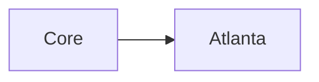

# NerdGram1337

NerdGram1337 is a local, single-user app for writing [Mermaid](https://mermaid.js.org/) diagrams as Markdown. It is [MIT](LICENSE) licensed, © Ryan Thomas Huff. You edit a diagram, preview it live, keep it as a real `.mmd` file on disk, and export **SVG**, **PNG**, **JPG**, or **PDF**. JPG and PDF are exports from the browser. The API and the CLI render SVG or PNG. There is no account, no hosted service, no AI generation, and no paywall. Optional GitHub sync can copy those diagrams to a private repository you own.

The **client** is a React app: the dashboard, the paste page, and the split editor. The **server** is an Express API that reads and writes the files. In development they run side by side. A production build, including the Docker image, serves the built client and the API from one process.

You start with sample diagrams: `Welcome.mmd`, `NetworkMap.mmd`, `Examples/Sequence.mmd`, and a linked pair, `WAN.mmd` and `Sites/Atlanta.mmd`. Anything you create is another file in that same folder.


A short screen recording of the dashboard and editor is in [screenshots/nerdgram1337_dashboard_editor_demo.mp4](screenshots/nerdgram1337_dashboard_editor_demo.mp4).

## Contents

- [Quick start](#quick-start)
- [Features](#features)
- [Generate from data](#generate-from-data)
- [Configuration](#configuration)
- [Automation API](#automation-api)
- [Command-line tool](#command-line-tool)
- [Install the CLI from npm](#install-the-cli-from-npm)
- [Security model](#security-model)
- [Data and backups](#data-and-backups)
- [Upgrading](#upgrading)
- [Update a Docker install](#update-a-docker-install)
- [Update a git clone](#update-a-git-clone)
- [Update a ZIP copy](#update-a-zip-copy)
- [Versioning and releases](#versioning-and-releases)
- [Troubleshooting](#troubleshooting)
- [Developing](#developing)
- [License](#license)

## Quick start

Run NerdGram with Docker, or with Node.js on the machine. Docker is the install to use when you want the app. Node.js is how you develop it, and it is also a full install when you do not want Docker. Use one of them at a time. Development and production both want port **8787**.

The app is for you, on this machine. The [security model](#security-model) is why every Docker command below publishes `127.0.0.1:8787:8787`, and why a Node install leaves `HOST` unset.

The Docker `pull` and `run` commands in this file use `v1.1.5`. That is `v` plus the `version` in the root `package.json`, and it is the tag [`compose.yaml`](compose.yaml) pins. Use the current tag on the [Releases page](https://github.com/NetworkNerd1337/NerdGram1337/releases) when you want a different release. [`npm run version:check`](#versioning-and-releases) fails if an image pin in this file, the Dockerfile, or `compose.yaml` disagrees with `package.json`. The names of planned releases are listed under [Versioning and releases](#versioning-and-releases).

### Docker

You do not need Node.js, and you do not need to clone this repository, to run the published image. The image is Node.js 22 on Debian bookworm-slim (`node:22.23.5-bookworm-slim`), pinned by digest in the `NODE_IMAGE` argument of the [Dockerfile](Dockerfile). The process inside the container listens on `0.0.0.0` so Docker can publish the port. The log warns that `0.0.0.0` is not loopback. That warning is expected. On the host, publish **`127.0.0.1:8787:8787`**. Publishing `8787:8787` or `0.0.0.0:8787` opens every host interface. That setup is unsupported.

The image is `ghcr.io/networknerd1337/nerdgram1337`. Each full release is a tag `vX.Y.Z`, the same tag as the GitHub Release. The workflow also pushes `:latest` for the newest full release. The tag to use is on the [Releases page](https://github.com/NetworkNerd1337/NerdGram1337/releases). [`compose.yaml`](compose.yaml) pins the tag that matches this tree. [`npm run version:check`](#versioning-and-releases) fails if an image pin in this file, the Dockerfile, or `compose.yaml` disagrees with `package.json`.

The package is public, so `docker pull` does not need a login. If a new package is still private, set **Public** once in the [package settings](https://github.com/users/NetworkNerd1337/packages/container/nerdgram1337/settings). The publish workflow warns when it cannot do that, and a successful image push still leaves the workflow green. See [Cutting a release](#cutting-a-release).

**1. Install Docker.** Install Docker Engine and the Compose plugin from [Docker's documentation](https://docs.docker.com/get-docker/). `docker version` and `docker compose version` should both print a version.

**2. Pull the image.** The command uses `v1.1.5`, the tag for this tree (the same pin as [`compose.yaml`](compose.yaml)). Use the current tag from the [Releases page](https://github.com/NetworkNerd1337/NerdGram1337/releases) when it differs. `:latest` is the newest full release.

```bash
docker pull ghcr.io/networknerd1337/nerdgram1337:v1.1.5
```

```bash
docker pull ghcr.io/networknerd1337/nerdgram1337:latest
```

**3. Start the container.** The named volume `nerdgram-data` is the whole workspace. One container per volume. Use the tag you pulled. If you pulled `:latest`, put that name on the last line instead.

```bash
docker run -d \
  --name nerdgram1337 \
  --restart unless-stopped \
  -p 127.0.0.1:8787:8787 \
  -e NERDGRAM_DATA_DIR=/data \
  -e NERDGRAM_INSTALL=docker \
  -v nerdgram-data:/data \
  ghcr.io/networknerd1337/nerdgram1337:v1.1.5
```

**About → Show upgrade steps** prints the run command with the real tag, the container name `nerdgram1337`, the volume `nerdgram-data`, and `127.0.0.1:8787:8787`. Updating an install you already have is [Update a Docker install](#update-a-docker-install).

**4. Open the app.** [http://127.0.0.1:8787](http://127.0.0.1:8787) or [http://localhost:8787](http://localhost:8787). The health check is [http://127.0.0.1:8787/api/health](http://127.0.0.1:8787/api/health). `installKind` is `docker`, and `dataDir` is `/data`.

The container runs as uid **1001**, gid **1001** (user `nerdgram`). A new named volume is writable by that user. A bind mount needs:

```bash
sudo chown -R 1001:1001 /path/to/nerdgram-data
```

If the directory is owned by root, the process exits and the log says it cannot write the data directory as that uid. An empty data directory is seeded once from the image's `diagrams/` folder. With `NERDGRAM_DATA_DIR=/data` the samples land at `/data/Welcome.mmd`, `/data/NetworkMap.mmd`, `/data/Examples/Sequence.mmd`, `/data/WAN.mmd`, and `/data/Sites/Atlanta.mmd`. The log says `Seeded empty data directory with the sample diagrams.` A directory that already has any entry is left alone.

`templates/` and `reference/` are in the image, not on the volume. With `NERDGRAM_DATA_DIR` set, a syntax-reference sync writes under `/data/.meta/reference` and survives a new container. Templates stay the ones in the image.

The published host port has to equal `PORT` inside the container (the image sets `8787`). The browser sends that port in the `Host` header. To use another port, set `PORT` in the container and publish `127.0.0.1:THAT:THAT`.

**Compose.** [`compose.yaml`](compose.yaml) publishes the same loopback port and mounts the same volume. It also sets a read-only root filesystem (`read_only: true`), `tmpfs` on `/tmp`, and `no-new-privileges`. The `docker run` above does not. The `image:` line is the published tag. From the directory that contains `compose.yaml`:

```bash
docker compose pull
docker compose up -d
```

Keep the volume mounted on `/data`. Compose and `docker run` both use the volume name `nerdgram-data`. If Compose warns that the volume already exists and was not created by Compose, that is the volume from an earlier `docker run`. Keep it.

**Build from this repository instead.** Pulling the published image is the usual install. Build locally when you want an image from a checkout or a ZIP. Clone is only for this path.

From a `Projects` folder (see [step 2 under Node.js](#nodejs) for the same `mkdir` and `cd` on macOS, Linux, and Windows):

```bash
git clone https://github.com/NetworkNerd1337/NerdGram1337.git
cd NerdGram1337
```

A ZIP of the repository works too. GitHub names that folder `NerdGram1337-main`. Either way, the folder you `cd` into contains the `Dockerfile`.

The Dockerfile uses BuildKit. The first line is `# syntax=docker/dockerfile:1`, and the `RUN` steps mount a cache with `--mount=type=cache`. Docker Engine 23 and newer, and current Docker Desktop, use BuildKit by default. `docker buildx version` should print a version. If this build stops on the syntax line or says `--mount` is unknown, prefix the command with `DOCKER_BUILDKIT=1`, or run `docker buildx build --load` with the same arguments. `docker buildx create --use` makes buildx the default builder when it is not already.

```bash
docker build \
  --build-arg NERDGRAM_VERSION="$(node -p "require('./package.json').version")" \
  --build-arg NERDGRAM_COMMIT="$(git rev-parse HEAD)" \
  -t nerdgram1337:local .
```

`node` and `git` are only used for those two arguments. The image itself has no git binary, and GitHub sync does not need one. Omit the `--build-arg` lines if you do not have `node` or `git`. `NERDGRAM_VERSION` then stays at the default in the Dockerfile, which matches the root `package.json`.

Start it with the same `docker run` as step 3, and use `nerdgram1337:local` as the image name. With Compose, from the project root:

```bash
docker compose -f compose.yaml -f compose.build.yaml up -d --build
```

That tags the image `nerdgram1337:local`. It does not label the local build with the published `vX.Y.Z` name. `docker compose pull` and `docker compose up -d`, without `compose.build.yaml`, still use the published tag in [`compose.yaml`](compose.yaml). Pass the commit when you have one: `NERDGRAM_COMMIT=$(git rev-parse HEAD) docker compose -f compose.yaml -f compose.build.yaml build`.

Optional variables go on `docker run -e`, or in a `.env` file next to `compose.yaml` (that file is gitignored):

- `NERDGRAM_GITHUB_CLIENT_ID` for GitHub sync. `NERDGRAM_GITHUB_TOKEN` is optional. The token file is `/data/.meta/github-token` with mode `0600`. The git working copy is `/data/.nerdgram-git`.
- `NERDGRAM_ALLOWED_HOSTS` and `NERDGRAM_CORS_ORIGINS` when you deliberately open the app on a name other than loopback. Saving from `diagrams.home` needs `NERDGRAM_ALLOWED_HOSTS=diagrams.home` and `NERDGRAM_CORS_ORIGINS=http://diagrams.home:8787`. That is still a single-user app with no login. See [Security model](#security-model).

### Node.js

**1. Check Node.js, npm, and Git.** On the host, use **Node.js 20 or newer** and **npm 10 or newer**. The CI verify job installs Node 20. The image and the Docker CI job use Node 22. The root `package.json` has no `engines` field, so npm will not refuse an older Node for you. Check:

```bash
node -v
npm -v
```

A usable result looks like `v20.x.x` or `v22.x.x`, and npm `10.x.x` or newer. `v18` and anything below 20 is too old. npm 9 and below is too old. Install Node.js 20 or newer from [https://nodejs.org/](https://nodejs.org/). The Windows and macOS installers include npm. On Linux, a distribution package can be an older Node, so check `node -v` after installing. Close the terminal and open a new one so the new install is on your `PATH`.

**Git** is required for `git clone` and for **Update now** on a git install. It is not required for the ZIP or for Docker. Check with `git --version`. Install it from [https://git-scm.com/downloads](https://git-scm.com/downloads) if you want to clone.

On macOS the built-in app is **Terminal**. On Windows use **PowerShell** or **Command Prompt**. On Linux use your distribution's terminal. An editor terminal works when `node -v` succeeds there.

**2. Get the code.** Put the project in a folder you can find again. A `Projects` directory in your home folder is a good spot.

| Shell | Create `Projects` and enter it |
| --- | --- |
| macOS or Linux | `mkdir -p "$HOME/Projects" && cd "$HOME/Projects"` |
| Command Prompt | `mkdir %USERPROFILE%\Projects` then `cd %USERPROFILE%\Projects` |
| PowerShell | `New-Item -ItemType Directory -Force -Path "$env:USERPROFILE\Projects"` then `Set-Location "$env:USERPROFILE\Projects"` |

That path is `/Users/you/Projects` on macOS, `/home/you/Projects` on Linux, and `C:\Users\you\Projects` on Windows. `$HOME`, `%USERPROFILE%`, and `$env:USERPROFILE` already expand to your home folder.

**Clone:**

```bash
git clone https://github.com/NetworkNerd1337/NerdGram1337.git
```

Git creates `NerdGram1337`.

**ZIP:** open [the repository](https://github.com/NetworkNerd1337/NerdGram1337), choose **Code**, then **Download ZIP**. The same archive is [main.zip](https://github.com/NetworkNerd1337/NerdGram1337/archive/refs/heads/main.zip). Extract it in `Projects`. GitHub names the folder `NerdGram1337-main`. The files match the clone. The ZIP has no `.git` directory, so the app treats that copy as a ZIP install.

**3. Open the project root.** Every `npm` command is run from the folder that contains the top-level `package.json`, next to `client/` and `server/`. npm reads the `package.json` in the current folder. If that file is missing, npm stops with `Could not read package.json`.

| How you got the code | macOS or Linux | Command Prompt |
| --- | --- | --- |
| git clone | `cd "$HOME/Projects/NerdGram1337"` | `cd %USERPROFILE%\Projects\NerdGram1337` |
| ZIP | `cd "$HOME/Projects/NerdGram1337-main"` | `cd %USERPROFILE%\Projects\NerdGram1337-main` |

PowerShell uses `Set-Location` with the same path, for example `Set-Location "$env:USERPROFILE\Projects\NerdGram1337"`. Confirm with `pwd` and `ls` (Command Prompt: `cd` and `dir`). You should see `package.json`, `client`, `server`, and `diagrams`.

The root scripts call `client/package.json` and `server/package.json` with `--prefix client` and `--prefix server`. `--prefix` tells npm which folder's `package.json` to use.

**4. Install dependencies.**

```bash
npm run install:all
```

That runs `npm install && npm install --prefix client && npm install --prefix server`. Root installs `concurrently` into `node_modules/`. Client installs React, Vite, and mermaid.js into `client/node_modules/`. Server installs Express and the server toolchain into `server/node_modules/`. The three `node_modules` folders together are roughly 900 MB, and on a typical connection the command takes a couple of minutes. The server install also downloads Puppeteer's chrome-headless-shell (about 260 MB) into Puppeteer's cache at `~/.cache/puppeteer`, or into `PUPPETEER_CACHE_DIR` when that is set. `npm install -g nerdgram1337` downloads that same shell, because the CLI package depends on puppeteer. You will see three install reports, each with a line like `added N packages`. Depending on the npm version and config, an audit summary may follow that line, or it may not appear at all. If the server summary lists high-severity findings, including ones that come from puppeteer, that is expected and the install still succeeded. The command does not start the app. Run it again after you update the code, delete a `node_modules` folder, or see a missing-package error.

**5. Run in development.**

```bash
npm run dev
```

That runs `concurrently -n server,client -c blue,magenta "npm run dev --prefix server" "npm run dev --prefix client"`.

- **server** runs `tsx watch src/index.ts`. The API listens on **127.0.0.1 port 8787** and, when IPv6 loopback is available, **::1 port 8787**. It does not listen on the LAN.
- **client** runs Vite bound to **localhost** on port **5173**. Vite may bind only `::1`. Use [http://localhost:5173](http://localhost:5173). If [http://127.0.0.1:5173](http://127.0.0.1:5173) does not connect, stay on `http://localhost:5173`. Requests to `/api` are proxied to `http://127.0.0.1:8787` (not `localhost`, which can resolve to `::1` first). Leave the API on 8787 during `npm run dev`. The proxy target is fixed in `client/vite.config.ts`.

Leave the terminal open. A successful start looks like this (the Vite version, the timing, the commit, and the data path will be yours):

```text
> nerdgram1337@X.Y.Z dev
> concurrently -n server,client -c blue,magenta "npm run dev --prefix server" "npm run dev --prefix client"

[server] > nerdgram1337-server@X.Y.Z dev
[server] > tsx watch src/index.ts
[client] > nerdgram1337-client@X.Y.Z dev
[client] > vite

[client]   VITE v8.x  ready
[client]   ➜  Local:   http://localhost:5173/
[server] NerdGram1337 API listening on http://127.0.0.1:8787
[server] NerdGram1337 API listening on http://[::1]:8787
[server] Data directory: /home/you/Projects/NerdGram1337/diagrams
[server] Install: git X.Y.Z <commit>
[server] Server module dir: /home/you/Projects/NerdGram1337/server/src
```

`X.Y.Z` is the root `package.json` version. On a ZIP copy, `Install:` says `zip`. If the log says it could not listen on `::1`, open [http://127.0.0.1:8787/api/health](http://127.0.0.1:8787/api/health) for the API. Day to day, use the UI URL. Vite forwards `/api` for you.

The health check returns JSON with `"ok": true`, `dataDir`, `version`, `commit`, and `installKind`.

**6. Stop, and start again later.** Press **Ctrl+C** in that terminal. Both processes exit, with lines like:

```text
[client] npm run dev --prefix client exited with code SIGINT
[server] npm run dev --prefix server exited with code SIGINT
```

Closing the terminal stops the app too. To start again, `cd` to the same root and run `npm run dev`. You do not need `install:all` again unless the code or `node_modules` changed.

**7. Run in production.** This builds static files and serves the UI and the API from one process. Stop the dev server first. Both modes want port 8787.

```bash
npm run build
npm start
```

`npm run build` runs the client build (`tsc -b && vite build`, output `client/dist/`) and then the server build (`tsc`, output `server/dist/`). It does not start the server. `npm start` runs `node dist/index.js` in `server/`. When `client/dist` exists, Express serves those files and sends other non-API routes to `client/dist/index.html`.

Open [http://127.0.0.1:8787](http://127.0.0.1:8787) or [http://localhost:8787](http://localhost:8787). There is no Vite server, so port 5173 will not respond. The log matches the dev server lines above, and `Server module dir` ends in `server/dist`. `npm start` does not watch files. After you change code, press Ctrl+C, run `npm run build`, then `npm start`.

`npm start` before a successful build fails because `server/dist/index.js` does not exist yet:

```text
Error: Cannot find module '.../server/dist/index.js'
```

Run `npm run build` from the project root, then `npm start` again.

Leave `HOST` unset. That listens on `127.0.0.1` and `::1`. `PORT` changes the production port (`PORT=8790 npm start`; Command Prompt: `set PORT=8790` then `npm start`; PowerShell: `$env:PORT = "8790"`). During `npm run dev`, leave the API on 8787. See [Configuration](#configuration) for `HOST`, `NODE_ENV`, and `NERDGRAM_DATA_DIR`.

A git clone is updated with [Update a git clone](#update-a-git-clone). A ZIP copy is updated with [Update a ZIP copy](#update-a-zip-copy).

## Features

The dashboard lists folders and diagrams in a tree, with search and grid or list view. You can create, rename, and delete folders and diagrams. Delete moves them to trash. Favorites are stored in `<data>/.meta/favorites.json` and return when you restore a diagram from trash. The paste flow is `/new`, and it uses the same folder picker as move and import.

Paths in this document use two placeholders, always in code formatting so GitHub does not treat the angle brackets as HTML tags. `<data>` is the data directory: `NERDGRAM_DATA_DIR` when that variable is set, and `diagrams/` inside the project when it is not. `<repo>` is the project folder, the git clone or the extracted ZIP.

The editor is split code and live preview, with autosave about **500 ms** after you stop typing and an **Auto-Update** preview. The code pane has Mermaid syntax highlighting, autocomplete (diagram types, keywords, arrows, snippets, and existing node IDs), bracket matching, and inline parse errors. A parse error underlines the line and column Mermaid reported, and the last diagram that rendered stays on screen, marked out of date. Export from the editor is SVG, PNG, JPG, or PDF. JPG and PDF are built in the browser from the live SVG, so the current theme is kept. The API and the CLI render SVG or PNG only. [Diagram checks](#diagram-checks) lists the warnings and the quick fixes.

### Editing

Opening a diagram takes a lock for that browser tab. Another tab, or a second NerdGram process pointed at the same data directory with a different `PORT`, can open it read-only and is told that it is already open. The editor sends a heartbeat every **15 seconds**. If the heartbeat is missing for **90 seconds**, or the server process that held the lock has exited, the lock is stale. The read-only banner then offers **Take over editing**. After you confirm, that window takes the lock. A window that is still sending heartbeats keeps the lock, so two editors do not write the same file. Closing the tab, or leaving the editor, releases the lock with a beacon the browser can deliver while the page is going away. If that release does not arrive, the lock still expires on the heartbeat timer. These locks are not accounts, and they do not stop you from editing the `.mmd` file in another program.

Each save sends the modification time and a content hash from the last time this editor loaded or saved the file. If the bytes on disk are different, autosave stops. You can reload the disk copy, overwrite the disk with your copy, or keep your copy without saving. Overwrite stores the disk copy as a revision first. Creating a diagram does not need a baseline. Saving over a file that already exists does: a second write with no baseline is refused, so a new diagram will not silently replace one that is already there.

You cannot rename, move, or trash a diagram, or a folder that contains it, while an editor still holds its lock. Close the editor first.

### Files

**Move to…** is on every diagram and folder, next to Rename and Delete. It opens a folder list, including the workspace root. Arrow keys move through that list. You can also drag the item onto a folder in the dashboard or the sidebar tree. The Dashboard item at the top of the sidebar is the workspace root. Trash is not a drop target.

A move that would land in the item's current folder, or put a folder inside itself or one of its subfolders, is refused. Dragging onto a diagram does nothing. If the destination already has that name, the drag is refused and nothing is overwritten. Move to… offers **Move as Name (copy)** (then **Name (copy 2)**, and so on). Favorites and revision history follow the file or folder.

**Duplicate** copies a diagram or a whole folder. The first copy is `Name (copy).mmd` (or `Name (copy)` for a folder), then `Name (copy 2)`. It never overwrites an existing item. The copy is not favorited, it does not share the source's editor lock, and it starts with no revision history. Hidden files, including anything under `.meta`, are not copied. If the diagram was generated from a data file that sits next to it, duplicate asks whether to copy that file or keep sharing the original. Copying writes `Name (copy).csv` (or `.json`, `.cdp`, `.lldp`, and an edges file when there is one) and points only the duplicate at it. Sharing leaves both diagrams on the original file. The original file is left unchanged either way.

Renaming or moving a diagram asks first when other diagrams link to it, then updates those `click` targets and lists the files it changed. A relative link inside a diagram that moved is updated too, so it still points at the same file. A data file that sits in the same folder moves with the diagram, and `nerdgram.source` is updated so **Refresh from data** still finds it. Renaming `Campus.mmd` to `Core.mmd` also renames `Campus.csv` to `Core.csv` and `Campus.lldp` to `Core.lldp`. A data file that lives in a different folder stays where it is. If another diagram already shares that file, the move copies it for the diagram that left and leaves the original bytes in place. A rename or move made outside the app does not do this by itself. **Repair links** can fix the `click` targets after you confirm a preview, and it updates `nerdgram.source` when the data file moved with the diagram. See [Linked diagrams](#linked-diagrams).

**Import** copies text you already have into the folder you are viewing, or into a folder you pick. Use **Import**, or drop `.mmd`, `.md`, and `.txt` files onto the dashboard or a folder. `.md` and `.txt` are stored as `.mmd`. Other file types are rejected. Each file can be up to 512 KB, with at most 25 files and 3 MB of text in one import. A dropped folder is not imported as a tree.

If a name is already in that folder, choose **Skip**, **Rename** (`Name 2.mmd`, then `Name 3.mmd`), or **Replace**. Nothing is overwritten unless you choose Replace. Replace keeps the previous text as a revision. A diagram that is open in an editor is not replaced. If Mermaid cannot parse a file, the dialog warns you and still lets you import it. The imported file is a normal diagram, not a link back to the original path.

### Trash and history

Delete moves a diagram or a folder into the trash. It does not erase the files. If other diagrams link to it, the app lists those files and asks you to confirm before the move. The links become broken-link warnings; they are not deleted for you. If a data file sits next to the diagram, delete asks whether to move that file to the trash too or leave it in the workspace. Trash takes the data file with the diagram, and restore puts it back beside the diagram. Keep leaves the file where it is. **Trash** in the sidebar restores an item or deletes it permanently. **Empty trash** removes everything in the trash for good.

Restore puts the item back at its original path. If something is already there, the app asks you to restore a copy (`Name (restored).mmd`, or `Name (restored 2)` and so on) or to replace the current item. Replacing moves that current item to the trash first. A folder is one trash entry. Restore puts the whole folder back.

Favorites come off the sidebar while an item is in the trash and go back when you restore it. If you restore to a different path, the favorite follows that path.

Every save that changes a diagram keeps the previous contents as a revision. **History** in the editor lists those revisions, shows the old text, and can restore one. Restoring writes the text you are replacing into history first. The last **20** revisions are kept for each diagram. Older ones are dropped. There is no age limit. Rename, move, and trash carry that history. Permanently deleting an item deletes its history.

History for scripts is on `/api`. `GET /api/history?path=Welcome.mmd` returns `path`, `retention`, and `revisions`. Each revision's id is the field `id`, alongside `createdAt`, `mtimeMs`, `size`, and `hash`. `POST /api/history/restore` expects `{"path","id"}`, and `id` is that revision id. A body that names `revisionId` instead is **400** (`path and id are required`). A save can return `revisionId` for the previous bytes it just archived. That value is a revision id, and the restore body still names the field `id`.

```bash
curl -fsS -X POST "http://127.0.0.1:8787/api/history/restore" \
  -H "Content-Type: application/json" \
  -d '{"path":"Welcome.mmd","id":"REVISION_ID"}'
```

The file you edit stays a plain `.mmd` file. Bookkeeping lives under the data directory:

- `.meta/trash/items/<id>/` — one soft-deleted file or folder, plus the favorites and revisions that belonged to it
- `.meta/versions/p_<encoded-path>/` — the previous contents of one diagram
- `.meta/locks/p_<encoded-path>.json` — the editor lock for one path

### Titles, themes, and notes

A diagram can start with [Mermaid's YAML front matter](https://mermaid.js.org/config/configuration.html). The title, theme, look, and layout are stored in the `.mmd` file, so they stay with it when you duplicate, import, or copy the folder.

```yaml
---
title: Network overview
config:
  theme: forest
  look: handDrawn
  layout: elk
nerdgram:
  description: Edge path into the lab
  tags:
    - network
  notes: |
    Draft for the lab write-up.
---
flowchart LR
  Internet --> Firewall
```

**Diagram info** in the editor edits the title, description, notes, and tags, and sets the theme, look, and layout. The preview toolbar has the same theme, look, and layout controls. The preview, dashboard thumbnails, and the editor's SVG, PNG, JPG, and PDF export use the theme in the file. If the file does not set one, they use **dark**.

The built-in Mermaid themes are `default`, `neutral`, `dark`, `forest`, `base`, `neo`, `neo-dark`, `redux`, `redux-dark`, `redux-color`, and `redux-dark-color`. Looks are `classic`, `handDrawn`, and `neo`. Layouts are `dagre` and `elk`.

The dashboard shows the title when the file has one, and the file name otherwise. A description is shown under the title. Tags are chips. Click a chip, or use the tag row, to filter the dashboard. Search also matches this text. A file name match is listed before a title, tag, description, note, or label match.

Description, notes, and tags live under `nerdgram:` because Mermaid has no field for them. Mermaid still reads `title` and `config` from the same header. A diagram with no front matter previews the same way as before. An older `%%{init: ...}%%` line still renders. The editor can move that config into the front matter. If the header is not valid YAML, the editor shows the error and leaves the file text alone.

`%%` at the start of a line is a Mermaid comment. In the code pane, Ctrl+/ (Cmd+/ on a Mac) comments or uncomments the selected lines.

### Diagram checks

The code pane checks the diagram while you type. The check waits about **400 ms** after the last key so a large file does not lag. Mermaid's parser supplies the syntax error, including the line and column. The other checks are warnings. They do not block the preview or autosave. A warning is a gutter mark and a row in the problems list under the code. Click a row to jump to that line. `nerdgram lint` runs the same checks on a file, or on the workspace when you point it at a running server. A Mermaid syntax error is reported as an error, with the line and column, and the command exits non-zero. `POST /api/lint` and `POST /api/v1/lint` do the same for one diagram. `GET /api/diagram-lint` and `GET /api/v1/lint` run the checks on the workspace.

The problems list can also offer a fix. **Rename** gives a duplicate id, or a class defined again with a different label, a new name. **Remove unused class** deletes a `classDef` nothing uses. **Create class** inserts a `classDef` for a name you already applied. **Declare class** and **Declare entity** insert the missing name. **Remove duplicate attribute** deletes the extra attribute line. **Remove duplicate** and **Remove empty node** delete a repeated or blank mindmap node, or a repeated or blank timeline event, when that line has no children. **Jump to definition** moves the cursor to the first definition of a duplicate id or class. Each of those can be undone with Ctrl+Z (Cmd+Z on a Mac). **Repair links** on a broken diagram link opens a preview of the rewrites. Confirming it saves the diagrams. Nothing is written before that confirmation.

Turn a warning off under **Diagram checks** on the settings page (`/settings#diagram-checks`). The sidebar links there on its own, next to GitHub sync and automation tokens. The switches are saved in this browser. A diagram Mermaid cannot parse is always marked.

| Rule | What it warns about |
| --- | --- |
| Duplicate ids | The same id is defined again with a different label. Flowcharts, sequence diagrams, and state diagrams. |
| Unconnected nodes | A flowchart node is defined but never used in a connection. A single node with no connections is left alone. |
| Unlabeled endpoints | A connection names a node that was never given a label. That is usually a typo. A flowchart that mostly uses bare ids, such as `A --> B`, is left alone, including when one extra node has a label. |
| Unused classes | A `classDef` is never applied with `class` or `:::`. `classDef default` is treated as used. |
| Undefined classes | A `class` or `:::` name has no `classDef`. |
| Front matter | The YAML header cannot be parsed, or a theme, look, layout, curve, ELK placement, title, description, or tag list is not one the file format accepts. |
| Broken diagram links | A `click` target that points at a workspace diagram (`nerdgram:`, `diagram:`, or a relative `.mmd` path) is missing, or the path leaves the workspace. Web links are not checked. |
| Duplicate classes | The same class name is defined again with a different label. Repeating `class Animal` to add members is left alone. |
| Undeclared classes | A class diagram relationship names a class that was never declared with `class` or a member line. A diagram that only uses relationships, with no `class` statement and no member line, is left alone. |
| Duplicate attributes | An entity lists the same attribute name more than once. The same name on two entities is left alone. |
| Undeclared entities | An ER relationship names an entity that was never declared with an attribute block or a bare entity line. A diagram that only uses relationships is left alone. |
| Missing task ids | A Gantt task uses `after` or `until` with an id that no task defines. An id defined later in the file still counts. |
| Invalid dates | A Gantt date does not match the diagram's `dateFormat`, or is not a real calendar date. Durations such as `3d`, and `excludes weekends`, are left alone. A `dateFormat` this check does not understand is left alone. |
| Duplicate siblings | A mindmap repeats a label under the same parent, or a timeline repeats an event in one period. The same label under a different parent, or the same event in a different period, is left alone. |
| Empty nodes | A mindmap node or a timeline event has no text. An icon line (`::icon(...)`) is not a node. |

On the dashboard, open **Workspace problems** to list those warnings for every diagram. When a warning is a broken diagram link, **Repair links** is on that list. A thumbnail whose diagram cannot be drawn shows a **Parse error** badge. A header that cannot be parsed shows **Front matter**.

### Linked diagrams

A node can open another diagram. The link is Mermaid's own `click` line, so the file stays valid Mermaid. Outside NerdGram the target is an ordinary link. Inside the preview and in presentation, a `nerdgram:` path or a relative `.mmd` path opens that diagram.



A path such as `./Rack.mmd` or `../WAN.mmd` is relative to the diagram that contains the line. `nerdgram:Sites/Atlanta.mmd` is the same path counted from the workspace root, which is the data directory. The older `diagram:` prefix is accepted the same way. The strings are in the `.mmd` file, so GitHub sync copies them with the diagram and they still resolve after a pull.

The sample pair is `WAN.mmd` and `Sites/Atlanta.mmd`. Click Atlanta on the overview to open the site. The trail along the top of the preview, and again in presentation, is the path you took, for example **WAN > Atlanta > Rack 3**, with **Back** and **Forward**. Presentation keeps that drill-down in the same full-screen view.

**Link node to diagram...** in the command palette inserts the `click` line. On a `click` line, autocomplete offers the diagrams in the workspace. A missing target is a warning in the problems list. Clicking it shows that message on the current diagram instead of opening a blank page. **Diagram info** lists **Links to** and **Linked from**.

Renaming or moving a diagram inside the app rewrites the `click` lines that point at it. A rename from the file manager, `git mv`, or a GitHub sync pull does not, so those links break. NerdGram remembers the path and content hash of each diagram it has seen, in `<data>/.meta/diagram-sightings.json`. **Repair links** compares that memory with the files now on disk. A path that disappeared and a new file that appeared in the same gap are a match when the content is the same, or, if the content is not, when the file name is the same and only one file fits. The dialog lists every rewrite. When the data file moved into the diagram's new folder, the same confirmation updates `nerdgram.source`. Confirming it saves those diagrams the same way an edit does, including revision history. Cancel, a dry run, or a preview writes nothing. If two files fit equally well, both are listed and neither is chosen. The same preview is `GET /api/link-repairs`, `GET /api/v1/link-repairs`, and `nerdgram repair-links`.

Only `nerdgram:`, `diagram:`, and a relative `.mmd` path navigate inside the app. An `http` or `https` address opens in a new tab and does not keep a handle back to this window. `javascript:` and any other scheme are blocked. A path that would leave the data directory is blocked the same way as a file operation.

### Generate from data

A CSV or JSON file can build the diagram. **From data** on the dashboard opens `/generate`. Paste the file or upload it, map columns, choose a flowchart direction and whether groups become subgraphs, preview the Mermaid, then create the diagram. The same action is **Generate diagram from data** in the command palette.

Two shapes are accepted. A links table has a local device, a local port, a remote device, and a remote port. A node list has an id and a label, and an optional second file of edges with source, target, and label. JSON can carry both lists in one object (`nodes` and `edges`) or a `links` array. Optional columns are group, type, style class, and a child diagram path. A group becomes a Mermaid `subgraph`. A type or style class becomes a `classDef` and a `class` line. A child diagram path becomes a `click` line such as `click Atlanta "nerdgram:Sites/Atlanta.mmd"`. The path has to be a `.mmd` file inside the workspace. `javascript:` and a path that leaves the workspace are rejected, and the error names the row.

Sample files are [docs/samples/campus-links.csv](docs/samples/campus-links.csv) and [docs/samples/campus.json](docs/samples/campus.json). The CSV is a links table. The JSON is nodes, edges, and a link from Atlanta to `Sites/Atlanta.mmd`.

The data file is saved next to the diagram (`Campus.mmd` and `Campus.csv`, or `Core.mmd` and `Core.lldp`). GitHub sync copies both. The diagram's front matter records the file, the column mapping, and the direction under `nerdgram.source`. CDP and LLDP also record `groupBy` and, when you typed one, the local device name. That path is from the workspace root. Renaming, moving, or duplicating the diagram moves or copies a data file that sits in the same folder and updates that path. Duplicate can instead keep sharing the original file. Delete can move the data file to the trash with the diagram or leave it in place. Generated lines sit between `%% nerdgram:generated` and `%% nerdgram:generated end`. **Refresh from data** in the editor reads that file, shows nodes and edges added, removed, and changed, and writes the generated block only after you apply it. Notes, the theme, and anything outside the markers stay, including a node you added by hand.

A file can be up to 512 KB, with at most 5,000 rows, 2,000 nodes, and 5,000 edges. A bad row, or a neighbor block that cannot be parsed, names its row or line and does not create the diagram. Labels are escaped so a cell or a hostname cannot close a Mermaid string or add a directive.

#### Cisco CDP and LLDP

**From data** also accepts pasted or uploaded command output. Choose **Cisco CDP** or **LLDP neighbors**. CDP is Cisco IOS, IOS-XE, and NX-OS. LLDP is vendor-agnostic: the parser reads the standard LLDP fields (local port, chassis ID, port ID, port description, system name, system description, system capabilities, and management address) whatever order or spelling the CLI uses. A link seen from both ends becomes one edge. `Gi1/0/1` and `GigabitEthernet1/0/1` are the same interface. Grouping can follow platform or capability. The raw output is the data file (`.cdp` or `.lldp`), and **Refresh from data** parses it again.

The hostname comes from the CLI prompt. If the paste has no prompt, type the local device name. You can paste several devices one after another.

| Platform | Command |
| --- | --- |
| Cisco IOS | `show cdp neighbors detail` and `show lldp neighbors detail` |
| Cisco IOS-XE | `show cdp neighbors detail` and `show lldp neighbors detail` |
| Cisco NX-OS | `show cdp neighbors detail` and `show lldp neighbors detail` |
| Arista EOS | `show lldp neighbors detail` |
| Juniper Junos | `show lldp neighbors interface <interface>` |
| ArubaOS-CX | `show lldp neighbor-info detail` |
| Aruba ProVision / AOS-Switch | `show lldp info remote-device detail` |
| HPE Comware | `display lldp neighbor-information verbose` |
| Dell OS10 | `show lldp neighbors detail` |
| Extreme EXOS | `show lldp neighbors detailed` |
| MikroTik RouterOS | `/ip neighbor print detail` |
| Linux lldpd | `lldpctl`, `lldpctl -f keyvalue`, or `lldpctl -f json` |

`lldpctl -f json` has no hostname in the file, so type the local device name. On Junos, paste one `show lldp neighbors interface <interface>` block per interface, in the same file. Sample output for each of these is under [docs/samples/neighbors](docs/samples/neighbors).

These commands need the [command-line tool](#command-line-tool), a running server, and `NERDGRAM_TOKEN`, and they are run from the repository root so the `docs/samples` paths resolve.

```bash
nerdgram generate --path Core.mmd --data docs/samples/neighbors/cisco-ios-cdp.cdp --format cdp
nerdgram generate --path Edge.mmd --data docs/samples/neighbors/lldpd.json --format lldp --local-device edge
```

### Thumbnails, find, and shortcuts

Dashboard cards keep a thumbnail of each diagram. The first time a card is on screen, the app draws it. After that, the picture is saved under `.meta/thumbs` and reused until the diagram changes. Scrolling a large folder only draws the cards you are about to see. A diagram that cannot be drawn shows “Preview unavailable” and the rest of the grid stays up.

**Ctrl** below means **Cmd** on a Mac. Find and go-to-line apply while the code pane is focused. The command palette applies everywhere except during presentation.

| Action | Keys |
| --- | --- |
| Command palette | Ctrl+K. The **Commands** button does the same thing when the browser takes the shortcut. |
| Find | Ctrl+F |
| Find next | Ctrl+G or F3 |
| Find previous | Ctrl+Shift+G or Shift+F3 |
| Close find | Esc, while the find panel is open |
| Select matches of the current selection | Ctrl+Shift+L |
| Go to line | Ctrl+Alt+G |
| Comment or uncomment | Ctrl+/ |
| Present | F5, or Ctrl+Shift+Enter |
| Address bar | Ctrl+L stays with the browser. The app does not bind it. |

The find panel can match case, whole words, or a regular expression, and it can replace one match or all of them.

On Windows, AltGr is reported as Ctrl+Alt. On a layout where AltGr+G types a character, Ctrl+Alt+G can type that character instead of opening Go to line. Use **Go to line** in the command palette.

The palette lists the actions already in the app: new diagram, paste, folder, import, generate from data, refresh from data, search, open, rename, move, duplicate, trash, restore, diagram info, link node to diagram, history, theme, export, present, find, go to line, templates, GitHub sync, About, and check for updates. Template, sync, and update commands do not add a shortcut. The app also leaves Ctrl+D for the browser bookmark and does not bind F11.

### Search

The sidebar search box matches file names and paths, titles, tags, descriptions, notes, and the visible text in a diagram: node and edge labels, subgraph titles, sequence messages, and similar labels. It does not match a diagram only because the file says `flowchart` or `sequenceDiagram`. Results show the matching text. Opening a result jumps to that line in the editor. The command palette uses the same search. **Names only**, under the search box, limits the dashboard to file names and paths. Diagrams in the trash are not included. The gallery has its own search. Dashboard search does not list the bundled templates.

### Presentation

**Present** shows the diagram on its own, using the theme, look, and layout stored in the file. The title is the front-matter title when the file has one, and the file name otherwise. The control bar can hide the title.

In the editor, use **Present** on the preview toolbar, press **F5**, or press **Ctrl+Shift+Enter** (**Cmd+Shift+Enter** on a Mac). **Present diagram** is also in the command palette. **F5** is the browser reload key. NerdGram uses it for presentation only when a diagram is open and the cursor is not in a form field (search, rename, diagram info, go to line, or the command palette). It does work from the code pane. On the dashboard, the new-diagram page, and the reference, F5 still reloads the page. Ctrl+F5, Alt+F5, and Shift+F5 stay a reload. Pan and zoom keys do not run while you are typing in the editor. They run only during presentation.

**Esc** or **Exit** leaves presentation and returns to the editor or the dashboard. If the browser is showing its own fullscreen and blocks the first Esc, press Esc again or use **Exit**.

A linked node drills into that diagram without leaving full screen. **Back**, **Forward**, and the trail (**WAN > Atlanta > Rack 3**) move through the diagrams you opened. The control bar still hides until you move the pointer or press Tab. Leaving presentation returns to the diagram you started from.

On the dashboard, **Present** on a card or a list row opens that diagram without the editor. The address looks like `/present/Welcome.mmd`. Presentation does not save the file and does not take the editor lock. A template opens at `/templates/present/<id>` and is not copied.

The bar hides after about 2.5 seconds. Move the pointer, or press Tab, to bring it back. It has zoom in, zoom out, the zoom percent, rotate left, rotate right, fit, title, full screen, and exit.

| Action | Keys and pointer |
| --- | --- |
| Zoom toward the pointer | Mouse wheel, or a trackpad pinch |
| Zoom toward the last pointer position, or the center | + or =, and - |
| Pan | Drag, a trackpad two-finger scroll, W A S D, or Shift+arrow |
| Pan after you have left the fitted view | Plain arrow keys. At the fitted view they do nothing, so a later slideshow can use them for the next diagram. |
| Rotate 90° | R clockwise, Shift+R the other way. Alt+drag rotates by any angle. |
| Fit, and clear zoom, pan, and rotation | 0 or F, or **Fit** |
| Leave | Esc or **Exit** |

Zoom from the keys and buttons stays between 10% and 800% of the diagram's own size. **Fit** can go outside that range so the whole diagram is visible. A quarter turn uses the rotated size, so a tall diagram turned sideways fills a landscape screen. If fullscreen is unavailable, the diagram still fills the window. **Full screen** tries again after a click. A bad header or a diagram that cannot be drawn shows the error. The last good picture stays up when a later refresh fails. Animated fades are skipped when the system asks for reduced motion.

### Template gallery

**New diagram** on the dashboard, **Browse templates** on the Paste Mermaid page, **Templates** in the sidebar, and the command palette all open the gallery at `/templates`. The palette lists **Open template gallery** and **New from template:** plus each template name. Those commands do not add a shortcut.

Each card shows a preview, the name, a short description, a category, and the diagram type. Search matches the name, description, tags, category, and diagram type. The category, type, and tag menus narrow the grid further. **Present** opens the template full screen without copying it.

**Use template** asks for a name and a folder. The folder list is the same picker used when you move a diagram. The app writes a new `.mmd` file and opens that copy in the editor. If the name is already there, the new file is `Name 2.mmd`, then `Name 3.mmd`. The existing file is left as it is. Editing the copy does not change the template.

The six starters are a network topology, a home lab, a firewall rule policy, a rack elevation, a flowchart, and a sequence. Addresses in them are documentation ranges from [RFC 1918](https://www.rfc-editor.org/rfc/rfc1918) and [RFC 5737](https://www.rfc-editor.org/rfc/rfc5737).

The files live in `templates/` at the project root, next to `reference/`. They are not in `diagrams/`, and they are not under `.meta`. To add one, drop a `.mmd` file in `templates/` and refresh the gallery. The file name is lowercase letters, numbers, and hyphens, such as `lab-wireless.mmd`. Files in subfolders are skipped. Start the file with Mermaid front matter: `title`, `config.theme` set to a built-in Mermaid theme, and a `nerdgram` block with `description`, `tags`, and `category`. The diagram has to be valid Mermaid or the preview shows “Preview unavailable.” No manifest is required.

`templates/` is part of the app. The image copies that folder in and leaves it read-only, the same way it copies `reference/`. Diagrams you create from a template are saved with your other diagrams. This version does not keep a separate folder of templates you save yourself.

### GitHub sync

GitHub sync is optional. The folder on this computer stays the copy NerdGram edits. A separate hidden folder, `<data>/.nerdgram-git`, is the git working copy. NerdGram does not turn the data directory into a git repository, and it does not need a git binary. Sync uses `isomorphic-git` inside the server. Turning sync off deletes that hidden folder and the saved authorization. The repository on GitHub stays in your account.

NerdGram does not ship a client ID or a client secret. You register an OAuth app in your own GitHub account. There is no operating-system keychain in a typical container. The token file mode `0600` is the stored secret.

**What is copied.** Synced files are the `.mmd` diagrams, the `.csv`, `.json`, `.cdp`, and `.lldp` data files stored next to a generated diagram, and the folders that contain them. The commit also includes a short README, `.gitignore`, and `.gitattributes` so the GitHub repository can be read on its own. A one-file commit is `Update Network/Core.mmd`.

These stay on this computer and are not pushed:

- `.meta` (favorites, syntax overrides, trash, version history, editor locks, thumbnails, the search index, the update cache, and the GitHub token)
- any other hidden path
- `templates/` and `reference/`, which live outside the data directory

Empty folders are not stored, because git does not keep empty directories. A folder appears once it contains a diagram.

Edits wait until the workspace has been idle for 20 seconds (`NERDGRAM_SYNC_IDLE_MS`) and then become one commit. Autosave still writes the file about 500 ms after you type. That does not create a commit per keystroke. Renames, moves, deletes, imports, and restores commit after about a second. A change made in another program is picked up by a reconciliation scan about once a minute (`NERDGRAM_SYNC_RECONCILE_MS`), or when you choose **Sync now**.

If GitHub has commits that this computer does not, NerdGram does not force-push. **Pull** brings those changes into the local folder through the normal save path, including a local revision snapshot. An open editor is not overwritten. When both copies changed, you choose **Keep local**, **Keep both**, or **Use GitHub copy**.

Connected sync resumes when the server starts again.

**1. Register an OAuth app**

1. Open [GitHub → Settings → Developer settings → OAuth Apps](https://github.com/settings/developers) and choose **New OAuth App**.
2. **Application name:** `NerdGram1337` (or any name you will recognize).
3. **Homepage URL:** `http://127.0.0.1:8787`
4. **Authorization callback URL:** `http://127.0.0.1:8787` (Device flow does not open this URL. GitHub's form still requires one.)
5. Register the app, then open it and enable **Device flow**.
6. Copy the **Client ID**. Leave the client secret unused. Do not commit it or put it in the NerdGram image.

The Device flow requests the `repo` scope. That is the smallest classic OAuth scope that can create a private repository and read and write its contents. It is broader than a single-file permission because GitHub does not offer a contents-only OAuth scope that can also create the repository.

If the repository already exists, you can skip Device flow and set `NERDGRAM_GITHUB_TOKEN` to a fine-grained personal access token with **Contents: Read and write** on that one repository. No other repository permission is required. A GitHub App installed on that same repository can use the same limit: **Contents** read and write, and **Metadata** read. Put an installation or user token in `NERDGRAM_GITHUB_TOKEN`. NerdGram's Device flow itself is for an OAuth app, which is the flow above.

**2. Connect**

Open **GitHub sync** in the app (the page is `/settings`), or run **GitHub sync status** from the command palette. Paste the client ID and choose **Connect to GitHub**. The page shows a code and a link to [https://github.com/login/device](https://github.com/login/device). Approve the app there. Then create the repository. The default name is `nerdgram-diagrams` and it is private. If that name already has commits, NerdGram asks before adding your diagrams on top. It does not erase the existing history and it does not force-push.

You can set the client ID in the environment instead of the form. On macOS or Linux, `NERDGRAM_GITHUB_CLIENT_ID=Iv1.yourClientId` before the command. On a container, pass the same variable and keep the data directory on a volume. The token file is under that directory's `.meta` folder, so it survives a new container. See the [environment table](#configuration) for the other shells.

**3. Where the token is stored**

| What | Where |
| --- | --- |
| Access token | `<data>/.meta/github-token`, mode `0600`, or `NERDGRAM_GITHUB_TOKEN` if that variable is set. The variable is not copied into the file. |
| Sync settings (account, repository URL, no token) | `<data>/.meta/github-sync.json`, mode `0600` |
| Git working copy | `<data>/.nerdgram-git` (hidden; the app cannot open it as a diagram) |

The token is not returned to the browser, not written into the git remote URL or `.git/config`, not put in a commit, and not written to the log. Git pushes send it only as an `Authorization` header for that request. Update checks do not use this token.

`NERDGRAM_GITHUB_CLIENT_SECRET` is read from the environment only, never stored, and is used solely to revoke the OAuth grant on disconnect. Without it, disconnect still deletes the local token. Revoke the grant yourself at [GitHub → Settings → Applications](https://github.com/settings/apps/authorizations). Delete the OAuth app from Developer settings when you want the app registration gone too. Disconnect does not delete the repository.

**4. Disconnect**

**Disconnect** asks you to confirm. The dialog states that the GitHub repository stays in your account. NerdGram then stops syncing, deletes `.nerdgram-git`, and deletes the saved token and sync settings. Diagrams in the data directory stay where they are.

### In-app updates

The running version is the **About** line at the bottom of the sidebar and **About NerdGram1337** in the command palette. Both show the version and its code name, for example `v1.1.5 "Atlas"`. `GET /api/version` returns `name`, `version`, `codename`, `commit`, and `installKind`. `GET /api/health` returns those fields plus `"ok": true` and `dataDir`. `installKind` is `git`, `docker`, `zip`, or `unknown`. `commit` is a SHA when the build or the git checkout has one, and null otherwise. Docker never shells out to git to discover a commit. Set `NERDGRAM_COMMIT` at image build time when you want one. When a newer release is available, the banner and the release dialog show that release's code name. The version still comes from the tag. The code name comes from the major number of that tag.

The server asks GitHub, with no token, whether `NetworkNerd1337/NerdGram1337` has a newer full release. That request uses the public Releases API for the latest stable release. It does not offer a prerelease. It does not use the GitHub sync token or `NERDGRAM_GITHUB_TOKEN`, and it does not send telemetry. The answer is cached for about 24 hours in `<data>/.meta/updates.json`. If GitHub is offline, rate-limits the check, or has not published a release yet, the automatic check stays quiet. **Check for updates** in the command palette can say that GitHub could not be reached. It has no keyboard shortcut. How a checkout of `main` differs from a checkout of a release tag is under [Pin a version or move to another](#pin-a-version-or-move-to-another).

`NERDGRAM_UPDATE_CHECK=false` (also `0`, `off`, or `no`) turns checks off, including **Check for updates** and **Update now**. Clearing **Check for updates automatically** in About stops only the automatic check. The checkbox is stored in `updates.json`. **Include prereleases** in About opts in to prereleases. `NERDGRAM_UPDATE_INCLUDE_PRERELEASE=true` (also `1`, `yes`, or `on`) opts in from the environment even when the checkbox is clear.

**Git clone.** On a clean checkout of this repository whose `origin` is `https://github.com/NetworkNerd1337/NerdGram1337` (or the matching `git@github.com:` / `ssh://git@github.com/` URL), on `main` or a detached release tag, **Update now** fetches the tag, fast-forwards only, runs `npm ci` in the root, `client/`, and `server/`, then `npm run build`, and tells you to restart. It stops if the tree is dirty, if `origin` is some other repository, if the branch is not `main` and not detached, or if the release is not a fast-forward. It does not force, reset away uncommitted work, or modify `NERDGRAM_DATA_DIR`. Extra diagrams under the data folder are ignored by git and are not a reason to stop when the rest of the tree is clean.

`npm ci` replaces `node_modules` under the process that is running the update. If install or build fails, NerdGram tries to return to the previous commit with `git reset --keep` (or a detached checkout of that commit). That reset refuses to discard uncommitted work. If the process dies in the middle, automatic rollback may not run. The error names the previous commit. From the project root, when the working tree is still clean:

```bash
git reset --keep <previous>
```

Then run `npm ci`, `npm ci --prefix client`, `npm ci --prefix server`, and `npm run build` again. Your diagrams are untouched.

After a successful update, stop the process and start it again (`npm run dev`, or `npm start` for a production build), then reload the page.

**Docker.** The app does not update itself inside the container. **Show upgrade steps** copies the pull, stop, remove, and run commands. See [Upgrading](#upgrading). **Check again** after you recreate the container says whether the running version matches that release.

**ZIP or an unknown copy.** You can read the release notes. There is no **Update now**. Download the new ZIP and keep your `diagrams` folder, or the same `NERDGRAM_DATA_DIR`.

### Syntax reference

NerdGram1337 ships a local mirror of the Mermaid diagram syntax docs so you can look up syntax with no internet connection. In the sidebar, **Open Syntax Reference Library**, or the same link in the editor top bar, opens `/reference`.

- Bundled mirror: `reference/manifest.json` and `reference/pages/*.md`, checked into the repo and copied read-only into the image.
- When `NERDGRAM_DATA_DIR` is set, a sync writes to `<data>/.meta/reference`. Reads use that copy when it has a manifest, and the bundled tree otherwise.
- When `NERDGRAM_DATA_DIR` is unset, sync replaces `reference/` at the repo root.
- Local annotations: `diagrams/.meta/syntax-overrides.json`, or `<data>/.meta/syntax-overrides.json` when `NERDGRAM_DATA_DIR` is set. These notes are per page and are not part of the replace.

While online, **Sync Syntax Reference** on the reference page fetches [the Mermaid syntax reference](https://mermaid.js.org/intro/syntax-reference.html) and the linked `/syntax/*.html` diagram pages, rebuilds the mirror in a staging folder, then replaces the live copy. The sync rewrites a few retired Mermaid URLs, including the old Getting Started page, onto the current docs pages so they are not copied back in. A successful sync updates `lastSyncedAt` in the manifest. A failed sync leaves the existing copy in place and the UI shows the error. From the project root:

```bash
npm run sync:reference --prefix server
```

Mirrored content is from the Mermaid documentation (MIT License). Each page keeps attribution and a link back to its source on [mermaid.js.org](https://mermaid.js.org/).

## Configuration

Set a variable in the same terminal before `npm run dev` or `npm start`, so the process inherits it. The Docker image already sets `HOST=0.0.0.0`, `PORT=8787`, `NERDGRAM_DATA_DIR=/data`, `NERDGRAM_INSTALL=docker`, and `NODE_ENV=production`.

| Shell | For the next command | For the rest of the session |
| --- | --- | --- |
| macOS or Linux | `NAME=value npm run dev` | `export NAME=value` |
| Command Prompt | `set NAME=value` then the command | same `set`, until the window closes |
| PowerShell | `$env:NAME = "value"` then the command | same assignment, until the window closes |

| Variable | Default | What it does |
| --- | --- | --- |
| `PORT` | `8787` | API port. Inside Docker this must equal the published host port. |
| `HOST` | unset, which binds `127.0.0.1` and `::1` | One address replaces that pair. `HOST=127.0.0.1` is IPv4 loopback only. `HOST=::1` is IPv6 loopback only. `HOST=0.0.0.0` or `HOST=::` listens beyond this machine, prints the unsupported warning, and is intended only inside the container. |
| `NODE_ENV` | inferred | Set `NODE_ENV=production` or `NODE_ENV=development` to override. Unset, a `tsx` dev process is development and `node dist/index.js` is production. Development allows the Vite origins on port 5173. |
| `NERDGRAM_DATA_DIR` | `<repo>/diagrams` | Absolute path of the workspace. The image uses `/data`. |
| `NERDGRAM_ALLOWED_HOSTS` | empty | Comma-separated extra `Host` names. `*` and `0.0.0.0` are ignored. This does not make a shared server supported. |
| `NERDGRAM_CORS_ORIGINS` | empty | Comma-separated extra origins for mutations, such as `http://localhost:5174`. Not a wildcard. |
| `NERDGRAM_INSTALL` | auto | `docker`, `git`, or `zip`. Any other explicit value is `unknown`. Unset, a `/.dockerenv` or `/run/.containerenv` file means docker, a `.git` at the app root means git, and a `package.json` means zip. |
| `NERDGRAM_COMMIT` | git `HEAD` on a git install, otherwise unset | Hex SHA of 7 to 40 characters baked into an image. Docker does not run git to find one. |
| `NERDGRAM_GITHUB_CLIENT_ID` | unset | OAuth client ID. Not a secret. |
| `NERDGRAM_GITHUB_TOKEN` | unset | Access token. When set, it is used instead of `.meta/github-token` and is not copied to disk. |
| `NERDGRAM_GITHUB_CLIENT_SECRET` | unset | Used only to revoke the OAuth grant on disconnect. Never stored. |
| `NERDGRAM_GITHUB_WEB` | `https://github.com` | GitHub website. Leave unset for github.com. |
| `NERDGRAM_GITHUB_API` | `https://api.github.com` | GitHub API. Leave unset for github.com. |
| `NERDGRAM_GITHUB_TIMEOUT_MS` | `20000` | GitHub HTTP timeout, clamped from 100 to 120000. |
| `NERDGRAM_SYNC_IDLE_MS` | `20000` | Quiet time before an edit becomes a commit, clamped from 0 to 600000. |
| `NERDGRAM_SYNC_RECONCILE_MS` | `60000` | How often a change from another program is picked up. `0` turns the timer off. Clamped to 86400000. |
| `NERDGRAM_SYNC_RETRY_MS` | `30000` | Retry delay, clamped from 5000 to 600000. |
| `NERDGRAM_SYNC_WATCH` | on | `0` turns the file watcher off. |
| `NERDGRAM_SYNC_MIRROR` | `<data>/.nerdgram-git` | Absolute path of the git working copy. It cannot be the data directory itself. |
| `NERDGRAM_UPDATE_CHECK` | on | `false`, `0`, `off`, or `no` blocks automatic and manual checks, and **Update now**. |
| `NERDGRAM_UPDATE_INTERVAL_MS` | `86400000` | Cache lifetime and automatic check interval, clamped from 1000 to 7 days. |
| `NERDGRAM_UPDATE_INCLUDE_PRERELEASE` | off | `true`, `1`, `yes`, or `on` includes prereleases even when the About checkbox is clear. |

`NERDGRAM_VERSION` is a Docker build argument, not a runtime variable. It has to match the root `package.json`, and the image label `org.opencontainers.image.version` records it. `NERDGRAM_CODENAME` is the code name for that version's major line. The image sets it in the environment and as `org.opencontainers.image.codename`. The running app still reads the code name from the `codenames` map in `package.json`.

The update tests also read `NERDGRAM_UPDATE_FIXTURE`, `NERDGRAM_UPDATE_SIMULATE`, `NERDGRAM_UPDATE_ALLOW_EXEC`, and `NERDGRAM_UPDATE_CHECK_IN_TEST`. Leave those unset.

A custom data directory on macOS or Linux:

```bash
export NERDGRAM_DATA_DIR="$HOME/Documents/nerdgram-diagrams"
npm run dev
```

One command, without exporting, is `NERDGRAM_DATA_DIR="$HOME/Documents/nerdgram-diagrams" npm run dev`. That folder is `/Users/you/Documents/nerdgram-diagrams` on macOS and `/home/you/Documents/nerdgram-diagrams` on Linux. Command Prompt: `set NERDGRAM_DATA_DIR=C:\Users\you\Documents\nerdgram-diagrams`. PowerShell: `$env:NERDGRAM_DATA_DIR = "C:\Users\you\Documents\nerdgram-diagrams"`. A concrete default folder is `/Users/you/Projects/NerdGram1337/diagrams` on macOS, `/home/you/Projects/NerdGram1337/diagrams` on Linux, and `C:\Users\you\Projects\NerdGram1337\diagrams` on Windows. Use `NerdGram1337-main` if you installed from the ZIP. The log line `Data directory:` is the path the server resolved. Favorites are `diagrams/.meta/favorites.json` (or `<data>/.meta/favorites.json`). Syntax-reference notes are `diagrams/.meta/syntax-overrides.json`.

An empty custom directory is seeded once with the sample diagrams, including the linked WAN and Atlanta pair. Any existing entry, including a hidden one, means the directory is left alone. The same path as the repo `diagrams/` folder is not copied onto itself.

`HOST=127.0.0.1 npm start` listens on IPv4 loopback only (Command Prompt: `set HOST=127.0.0.1` then `npm start`; PowerShell: `$env:HOST = "127.0.0.1"`). `HOST=::1` listens on IPv6 loopback only. If `http://localhost:8787` does not open, use `http://127.0.0.1:8787`. The same variable applies to `npm run dev`. Set `NODE_ENV=development` or `NODE_ENV=production` only when you need to override the inferred mode.

## Automation API

`/api/v1` is for scripts, CI, and other tools. The browser UI keeps using `/api` and does not send a token. Create a token under **Automation tokens** on the settings page (`/settings`). The token is shown once. The server stores a SHA-256 hash in `<data>/.meta/api-tokens.json` (mode `0600`) and compares it in constant time. Revoke a token on that same page. A revoked token stops working immediately.

A token is `read` or `read-write`. Read can list, search, fetch source, export, lint, render, and preview link repairs. Read-write can also create, update, rename, move, duplicate, trash, generate, refresh, and apply link repairs. A read token that tries to write gets **403**. A missing, wrong, or revoked token gets **401**.

The OpenAPI document is `GET /api/v1/openapi.json`. That one route does not require a token. Every other `/api/v1` route does. Host and Origin checks still apply, including on token routes. A foreign `Host` is **403**. Every `POST`, `PUT`, `PATCH`, and `DELETE` needs `Content-Type: application/json`, including `DELETE /api/v1/diagrams`. Without that header the response is **415** and `{"error":"Content-Type must be application/json"}`. A foreign `Origin` is **403**. A token does not turn those checks off. The same header is required on the browser routes under `/api`. See [Security model](#security-model).

```bash
curl -fsS "http://127.0.0.1:8787/api/v1/diagrams" \
  -H "Authorization: Bearer ng_your_token"

curl -fsS "http://127.0.0.1:8787/api/v1/diagrams/content?path=Welcome.mmd" \
  -H "Authorization: Bearer ng_your_token"

curl -fsS -X POST "http://127.0.0.1:8787/api/v1/render" \
  -H "Authorization: Bearer ng_your_token" \
  -H "Content-Type: application/json" \
  -d '{"path":"Welcome.mmd","format":"svg"}' \
  -o Welcome.svg
```

Rename and move update `click` links the same way the editor does after you confirm. Pass `"updateLinks": false` to refuse the change when another diagram links there (**409**, with the file list). A CSV, JSON, CDP, or LLDP file in the same folder moves with the diagram, and the response `dataFiles` list is the old path and the new path. `nerdgram.source` is updated. Duplicate is `POST /api/v1/diagrams/duplicate`. When a sibling data file exists, omit `copyData` and the call returns **409** with `files`. `"copyData": true` copies the file and points the duplicate at the copy. `"copyData": false` shares the original file and does not change it. Delete is `DELETE /api/v1/diagrams`. It answers **200** with `path` and `trashed`. The path can be a query parameter or a JSON field. Send `Content-Type: application/json` and a JSON body. `{}` is enough when `path` is in the query string. When a sibling data file exists, omit `deleteData` and the call returns **409** with `files`. `"deleteData": true` moves that file to the trash with the diagram. `"deleteData": false` leaves it in the workspace. `nerdgram rename`, `nerdgram move`, `nerdgram duplicate` (`--copy-data` or `--share-data`), and `nerdgram delete` (`--with-data` or `--keep-data`) call those routes. An editor lock returns **423**. Paths stay inside the data directory.

```bash
curl -fsS -X DELETE "http://127.0.0.1:8787/api/v1/diagrams" \
  -H "Authorization: Bearer ng_your_token" \
  -H "Content-Type: application/json" \
  -d '{"path":"Notes.mmd"}'
```

`GET /api/v1/link-repairs` previews repairs after a diagram was renamed or moved outside the app, including by a sync pull. Nothing is written. `POST /api/v1/link-repairs` writes only when the body is `{"dryRun":false,"confirm":true}`. Leave `dryRun` out, or set it true, and the response is the same preview. `choices` is the list of `from` and `to` paths you already previewed. Omit it to apply every suggestion that has one target. A suggestion with more than one target is never applied. A pair that is not in the current preview is **409**.

Lint reuses the same checks as the editor:

```bash
curl -fsS "http://127.0.0.1:8787/api/v1/lint?path=Welcome.mmd" \
  -H "Authorization: Bearer ng_your_token"
```

Generate and refresh use the same CSV and JSON pipeline as [Generate from data](#generate-from-data). `save: true` writes the refreshed diagram. Without it, the response is the new source and the diff, and the file stays as it was.

```bash
curl -fsS -X POST "http://127.0.0.1:8787/api/v1/generate" \
  -H "Authorization: Bearer ng_your_token" \
  -H "Content-Type: application/json" \
  -d '{"path":"Campus.mmd","text":"Local Device,Remote Device\nCore,Atlanta\n"}'
```

Render runs headless Chrome (the `chrome-headless-shell` build, not the full browser) so SVG and PNG match the editor. `format` is `svg` or `png` on `POST /api/v1/render` and on `GET /api/v1/render`. `jpg`, `pdf`, and any other value are **400** with `{"error":"format must be svg or png","code":"invalid"}`. A DOM emulator was not accurate enough for layout. The shell adds about 260 MB unpacked, plus the shared libraries the image installs for it. That is the size cost of a correct picture. Render is limited to 30 calls a minute per token (**429**, `Retry-After`). Posted source is limited to 512 KB, and the SVG is sanitized the same way cached thumbnails are.

The server still binds to `127.0.0.1` and `::1` when `HOST` is unset. A token does not make it safe to publish port 8787. The browser routes under `/api` stay open on purpose, for the UI on this machine. Anyone who can reach a published port can use those routes without a token.

## Command-line tool

`nerdgram` is the client for that API. It talks to a NerdGram server on this machine, or on another machine you can reach. `lint` and `render` of a `.mmd` file that is already on disk do not need the server.

### Install the CLI from npm

The package name on npm is `nerdgram1337`. The command it installs is `nerdgram`. Node.js 20 or newer and npm 10 or newer are the same versions [the app uses](#nodejs).

```bash
npm install -g nerdgram1337
```

```bash
npx nerdgram1337 --help
```

`npm install -g` puts `nerdgram` on your `PATH`. If the shell cannot find it, open a new terminal. npm warns when its global bin directory is not on `PATH`. `npx` downloads the package and runs the command without a global install. Point `NERDGRAM_URL` at the running app. The default is `http://127.0.0.1:8787`, which is right when the app is on the same computer.

**Do not run `npx nerdgram1337` inside this repository.** The root `package.json` is also named `nerdgram1337` and has no `bin`. From the checkout, npm stops with `could not determine executable to run`. Use `npm install -g` or `npx` from any other directory. Inside the running container, run `nerdgram` (below). From this checkout, use `node server/dist/cli.js` after `npm run build`, below.

The package is public. The install also downloads Mermaid and Puppeteer's chrome-headless-shell, because offline `lint` and `render` use them. That shell is the large part of the install. The same kind of shell is what the server image uses for pictures. Commands that only call the API do not launch it.

A checkout runs the same program from the server build. After `npm run build`, from the repository root, that is `node server/dist/cli.js`. Use that in place of `nerdgram` when you run the commands below from a checkout. The `nerdgram` bin in `server/package.json` points at `server/dist/cli.js`, but `npm run install:all` does not link it, so `npm exec --prefix server -- nerdgram` does not print the command list. The shell reports `nerdgram: not found`. The `cli/` directory is what gets published. Its `prepack` script bundles that program into `cli/dist` before `npm pack` or `npm publish`. The Docker image does not use the bundle. It puts `node /app/server/dist/cli.js` on `PATH` as `nerdgram`. The package readme that npm shows is [`cli/README.md`](cli/README.md). The same install and command list is in [`docs/cli.md`](docs/cli.md).

From a checkout, after `npm run build`:

```bash
node server/dist/cli.js --help
```

Inside the running container:

```bash
docker exec -e NERDGRAM_TOKEN=ng_your_token nerdgram1337 nerdgram list
```

`NERDGRAM_URL` defaults to `http://127.0.0.1:8787`. `NERDGRAM_TOKEN` is the token from Settings. `--url` and `--token` override them. `--json` prints one JSON object and nothing else. The process exits `1` when the command fails.

```bash
export NERDGRAM_URL=http://127.0.0.1:8787
export NERDGRAM_TOKEN=ng_your_token

nerdgram list
nerdgram search Atlanta
nerdgram get Welcome.mmd -o Welcome.mmd
nerdgram put Notes.mmd ./Notes.mmd
nerdgram export Examples -o ./exported
nerdgram lint Welcome.mmd
nerdgram repair-links
nerdgram repair-links --apply
nerdgram generate --path Campus.mmd --data docs/samples/campus-links.csv
nerdgram generate --path Core.mmd --data docs/samples/neighbors/cisco-ios-lldp.lldp --format lldp
nerdgram refresh Campus.mmd
nerdgram render Welcome.mmd -o Welcome.svg
nerdgram render Welcome.mmd -o Welcome.png
```

`render` writes `.svg` or `.png`. Another extension stops with `The output file must end in .svg or .png.` `--server` posts that format to the API, which accepts `svg` or `png` only. `render` of a `.mmd` file that exists on disk does not need a server. `lint` of a local file does not either. `nerdgram lint Welcome.mmd` is a workspace path: it needs a running server and `NERDGRAM_TOKEN` unless a file named `Welcome.mmd` is already in the current directory. In a checkout the sample is `diagrams/Welcome.mmd`, and `nerdgram lint diagrams/Welcome.mmd` (from a checkout, `node server/dist/cli.js lint diagrams/Welcome.mmd` after `npm run build`) does not need a server. The `generate` lines that pass `docs/samples` are run from the repository root, and they need the server and token. `--server` sends `render` to the API instead. `lint` exits `1` when a diagnostic is an error. `--strict` also exits `1` for warnings.

`nerdgram repair-links` prints the preview and writes nothing. `--dry-run` is the same. `--apply` saves the rewrites. A read token can run the preview. `--apply` needs a read-write token.

A CI job can render every diagram in the repo without a token, because that path is offline:

```yaml
name: diagrams
on: [push]
jobs:
  render:
    runs-on: ubuntu-latest
    steps:
      - uses: actions/checkout@v4
      - uses: actions/setup-node@v4
        with:
          node-version: 22
      - run: npm ci --prefix server
      - run: npm run build --prefix server
      - name: Render
        run: |
          mkdir -p out
          find diagrams -name '*.mmd' -print0 | while IFS= read -r -d '' file; do
            node server/dist/cli.js render "$file" -o "out/$(basename "$file" .mmd).svg"
          done
```

To render from a running server instead, create a read token, store it as a secret, and set `NERDGRAM_URL` and `NERDGRAM_TOKEN`.

## Security model

NerdGram1337 is a local, single-user personal tool. It has no accounts and no login, by design. Diagrams are plain `.mmd` files. An in-app login would not protect anything the operating system does not already protect. Your OS account and the permissions on the data directory are the access control. Automation tokens, described in [Automation API](#automation-api), apply only to `/api/v1`. They do not cover the browser routes.

Shared servers, a computer offered as a service, and NAS deployments are unsupported. Do not forward port 8787 or 5173, and do not publish `8787:8787`.

**What the process binds to.** With `HOST` unset, the API listens on `127.0.0.1` and then `::1` on the same port. If `::1` is unavailable, IPv4 loopback still serves, and the log says to use `http://127.0.0.1:<port>` when `localhost` does not open. Vite's dev server listens on `localhost` only. The image sets `HOST=0.0.0.0` so the published port works, and the log prints a warning that this is not loopback, that the browser API has no authentication, and that the only intended use is a container whose host publish is `127.0.0.1:8787:8787`. That warning is expected in the container. A bearer token on `/api/v1` does not change it. Publishing `8787:8787` still exposes the browser routes to anyone who can open the port.

**Checks on every request.** The `Host` header has to be a loopback name the server allows: `localhost`, `127.0.0.1`, or `::1`, including the API port. Any other `Host` is **403** (`Forbidden host`). That blocks a public DNS name that points back at your machine. `NERDGRAM_ALLOWED_HOSTS` adds extra hostnames. Adding one does not make shared-server use supported.

**Checks on changes.** `POST`, `PUT`, `PATCH`, and `DELETE` on `/api` and `/api/v1` require `Content-Type: application/json`. That includes `DELETE` and the POST routes that take no fields: `/api/trash/empty`, `/api/reference/sync`, `/api/sync/now`, `/api/sync/pull`, `/api/sync/device/start`, `/api/updates/check`, `/api/updates/skip`, `/api/updates/later`, and `/api/updates/apply`. Anything else, including a missing header or a browser form, is **415** with `{"error":"Content-Type must be application/json"}`. The curl examples include a JSON body. `{}` is enough when the path or id is already in the URL or the query string: `DELETE /api/item`, `DELETE /api/trash/item`, `DELETE /api/tokens/:id`, and `DELETE /api/v1/diagrams`. `DELETE /api/item` and `DELETE /api/trash/item` answer **204**. `DELETE /api/tokens/:id` answers **200**. Browsers also send `Origin` and `Sec-Fetch-Site`. The origin has to be the API itself (`http://127.0.0.1:8787`, `http://localhost:8787`, or `http://[::1]:8787`, on whatever `PORT` is). In development, `http://localhost:5173`, `http://127.0.0.1:5173`, and `http://[::1]:5173` are allowed too. `NERDGRAM_CORS_ORIGINS` adds explicit origins. It is not a wildcard. A foreign origin is **403**. `Sec-Fetch-Site` of `cross-site` is rejected unless that `Origin` is on the list. `same-origin`, `same-site`, and `none` are accepted. A local `curl` that sends neither `Origin` nor `Sec-Fetch-Site` is accepted. It still has to send `Content-Type: application/json`.

```bash
curl -fsS -X PUT "http://127.0.0.1:8787/api/file" \
  -H "Host: 127.0.0.1:8787" \
  -H "Origin: http://127.0.0.1:8787" \
  -H "Content-Type: application/json" \
  -d '{"path":"Notes.mmd","content":"flowchart LR\n  A --> B\n"}'

curl -fsS -X DELETE "http://127.0.0.1:8787/api/item?path=Notes.mmd" \
  -H "Host: 127.0.0.1:8787" \
  -H "Content-Type: application/json" \
  -d '{}'

curl -fsS -X DELETE "http://127.0.0.1:8787/api/tokens/TOKEN_ID" \
  -H "Host: 127.0.0.1:8787" \
  -H "Content-Type: application/json" \
  -d '{}'
```

Production does not enable cross-origin browser access, because the UI and the API are the same port. Development CORS allows only the origins listed above.

**Files.** Paths stay inside the data directory. The server rejects null bytes, hidden paths such as `.meta`, and any path that escapes that directory. Diagram writes must be `.mmd` files. A `click` link is checked with that same rule: `nerdgram:` and relative `.mmd` paths cannot leave the data directory, and `javascript:` is not opened. Editor locks only keep two windows from writing the same diagram.

**GitHub and updates.** The sync token is stored as described in [GitHub sync](#github-sync). Sync and **Update now** use the same Host, Origin, and JSON checks as other changes. Update checks call the public Releases API with no token. Treat the data directory, `.meta`, and `.nerdgram-git` as personal documents: use your OS permissions, and do not share that folder casually.

## Data and backups

By default, diagrams live in `diagrams/` inside the project. The server creates that directory on startup if it is missing and prints the absolute path as `Data directory:`.

In Docker, the named volume `nerdgram-data` mounted at `/data` is the whole workspace: `.mmd` files, `.meta` (trash, version history, locks, thumbnails, the search index, `updates.json`, syntax overrides, a synced reference, and the GitHub token), and `.nerdgram-git`. Copy the whole volume, including those hidden directories. One volume is one workspace.

Stop the container, then copy the volume out. `tar` is in the image. The entrypoint is the server, so replace it, and use the image you actually run. A checkout build is `nerdgram1337:local`. The published image is `ghcr.io/networknerd1337/nerdgram1337:v1.1.5` (the tag [`compose.yaml`](compose.yaml) pins; use the current [Releases](https://github.com/NetworkNerd1337/NerdGram1337/releases) tag, or `:latest`, when that differs). The process runs as uid 1001, so the folder that receives the archive has to be writable by that user.

Local build:

```bash
docker stop nerdgram1337
mkdir -p nerdgram-backup
sudo chown 1001:1001 nerdgram-backup
docker run --rm --entrypoint tar \
  -v nerdgram-data:/data:ro \
  -v "$PWD/nerdgram-backup":/backup \
  nerdgram1337:local \
  -C /data -czf /backup/nerdgram-data.tgz .
sudo chown "$(id -u):$(id -g)" nerdgram-backup/nerdgram-data.tgz
```

Published image. Same command, with `ghcr.io/networknerd1337/nerdgram1337:v1.1.5` in place of `nerdgram1337:local`:

```bash
docker stop nerdgram1337
mkdir -p nerdgram-backup
sudo chown 1001:1001 nerdgram-backup
docker run --rm --entrypoint tar \
  -v nerdgram-data:/data:ro \
  -v "$PWD/nerdgram-backup":/backup \
  ghcr.io/networknerd1337/nerdgram1337:v1.1.5 \
  -C /data -czf /backup/nerdgram-data.tgz .
sudo chown "$(id -u):$(id -g)" nerdgram-backup/nerdgram-data.tgz
```

The archive is the whole `/data` tree, including hidden `.meta` and, when sync has been connected, `.nerdgram-git`. A bind mount is a normal directory. Copy that directory the same way, including those hidden folders.

On a Node install, copy the `diagrams/` folder, or the directory `NERDGRAM_DATA_DIR` points at, the same way you copy any other personal folder. Include the hidden `.meta` directory. The in-app folder tree hides `.meta`. The `.mmd` files themselves stay plain text.

`git` ignores extra files under `diagrams/` and ignores `diagrams/.meta/`. The sample diagrams, including `WAN.mmd` and `Sites/Atlanta.mmd`, are tracked. A custom `NERDGRAM_DATA_DIR` outside the repo is not part of the git checkout.

Do not run `docker volume rm` on a volume you still want.

## Upgrading

Stop the app before you replace it. Diagrams stay where they are when you keep the same data directory or the same volume. Do not run `docker volume rm` on a volume you still want. There is no updater inside the container.

### Update a Docker install

The in-app **Show upgrade steps** dialog uses these commands with the real tag, the container name `nerdgram1337`, the volume `nerdgram-data`, and `127.0.0.1:8787:8787`. The examples below use `v1.1.5`, the tag for this tree. Use the current tag on the [Releases page](https://github.com/NetworkNerd1337/NerdGram1337/releases) when you are moving to a different release. If your names differ, keep the names you already use.

1. Pull the new image.

```bash
docker pull ghcr.io/networknerd1337/nerdgram1337:v1.1.5
```

2. Stop the old container. `docker stop` asks the process to finish the write it is in and any GitHub sync already running.

```bash
docker stop nerdgram1337
```

3. Remove the old container. The volume stays.

```bash
docker rm nerdgram1337
```

4. Start it again on the same volume and the same loopback port.

```bash
docker run -d \
  --name nerdgram1337 \
  --restart unless-stopped \
  -p 127.0.0.1:8787:8787 \
  -e NERDGRAM_DATA_DIR=/data \
  -e NERDGRAM_INSTALL=docker \
  -v nerdgram-data:/data \
  ghcr.io/networknerd1337/nerdgram1337:v1.1.5
```

5. Open [http://127.0.0.1:8787](http://127.0.0.1:8787) and choose **Check again** in About. The dialog says whether the running version matches that release.

These `docker run` lines match the in-app steps. They do not set a read-only root or a `tmpfs` on `/tmp`. `compose.yaml` does. If you installed with Compose, change the pinned tag in `compose.yaml` when the file pins an older `vX.Y.Z`. If the image line is `:latest`, pull and up are enough. Then:

```bash
docker compose pull
docker compose up -d
```

Keep the volume mounted on `/data`.

### Update a git clone

From the project root, with the app stopped (Ctrl+C):

1. Pull tracked files. Diagrams you created under `diagrams/` stay put, because git ignores those extra files and ignores `diagrams/.meta/`. The sample diagrams are tracked. If you edited one of them, including `diagrams/WAN.mmd` or `diagrams/Sites/Atlanta.mmd`, git may stop and ask you to handle those local edits before the pull can finish.

```bash
git pull
```

2. Install again. The pull can change lockfiles.

```bash
npm run install:all
```

3. Start the same way you were running it: `npm run dev`, or `npm run build` and then `npm start`.

A clean git clone whose `origin` is this repository can do the same fetch, fast-forward, `npm ci`, and build from **Update now** in About. You still restart afterwards. See [In-app updates](#in-app-updates). `npm ci` replaces `node_modules` under the running process. If the process dies in the middle, the error names the previous commit and the recovery is `git reset --keep <previous>` from the project root, then the three `npm ci` commands and `npm run build` again. Diagrams are untouched.

### Update a ZIP copy

There is no **Update now** for a ZIP. About shows the hand steps.

1. Download a fresh ZIP from [main.zip](https://github.com/NetworkNerd1337/NerdGram1337/archive/refs/heads/main.zip) or from the release page, and extract it to a new folder. GitHub names a `main` archive `NerdGram1337-main`.
2. `cd` into that folder and run `npm run install:all`. The ZIP does not include `node_modules`.
3. If your diagrams are still in the old project's `diagrams/` folder, copy that folder into the new project, including the hidden `.meta` directory. If you set `NERDGRAM_DATA_DIR`, point the new copy at the same path and leave the files where they are.
4. Start with `npm run dev`, or `npm run build` and `npm start`.

## Versioning and releases

Releases are semantic versions: `vX.Y.Z`, three numbers with no prerelease suffix. `X` is the major line, `Y` is the maintenance line, and `Z` is the patch. The root `package.json` `version` is the version of the tree you have. A GitHub Release and its git tag use the same numbers with a leading `v`.

This tree is v1.1.5, code name Atlas. v1.0.5 was the first release on this line, and v1.0.6 was the patch after it. Each published tag has a GitHub Release and a container image. Both are listed on the [Releases page](https://github.com/NetworkNerd1337/NerdGram1337/releases). Later 1.x.y releases stay Atlas. The image for this tree is `ghcr.io/networknerd1337/nerdgram1337:v1.1.5` once the `v1.1.5` tag is pushed.

### Version numbers and code names

Each major number has one code name for as long as that line is published. Maintenance releases keep the code name and change `Y` or `Z`.

| Major line | Code name | First release on that line |
| --- | --- | --- |
| 1 | Atlas | v1.0.5 |
| 2 | Meridian | v2.0.0 |

v1.0.5 was the first release. Every later 1.x.y release is still Atlas. v1.1.5 is the version of this tree. Meridian begins at v2.0.0 and is the name of every 2.x.y release after that.

Which number moves:

- **Patch (`Z`).** A small fix. The code name stays, and only the third number changes.
- **Minor (`Y`).** A larger maintenance change on the same major line. The second number increases, the third goes back to 0, and the code name stays.
- **Major (`X`).** A new line and a new code name. The one after Atlas is v2.0.0, Meridian.

The running app shows the version and the code name together. A 1.x.y build is Atlas. A 2.x.y build is Meridian. The `codenames` map in the root `package.json` is the source of truth (`"1"` is Atlas, `"2"` is Meridian). A major version with no entry fails `npm run version:check`. The GitHub Release title for a tag is `vX.Y.Z "Code name"`.

### Where the version is shown

- The bottom of the sidebar is **About** and the version with its code name, written `v1.1.5 "Atlas"`.
- **About NerdGram1337** in the command palette opens the same panel: that same version line, commit when there is one, and the install kind (git clone, Docker, ZIP, or unknown).
- `GET /api/version` returns `name`, `version`, `codename`, `commit`, and `installKind`.
- `GET /api/health` returns those fields plus `"ok": true` and `dataDir`.
- When a newer release is available, the update banner and the release dialog show that release's code name, from the major number of the release tag. The update check still parses the tag for the version. It does not parse the release title as the version.

`commit` is a SHA baked in with `NERDGRAM_COMMIT`, or the git `HEAD` of a git install. Docker does not run git to find one. A Compose build that omits `NERDGRAM_COMMIT` reports `commit` as null.

### Pin a version or move to another

The Docker `pull` and `run` commands use `v1.1.5`, the Atlas tag for this tree, so they can be copied. Use the current tag on the [Releases page](https://github.com/NetworkNerd1337/NerdGram1337/releases) when you want a different release. Git and ZIP examples in this section still write the tag as `vX.Y.Z`. Substitute the release you want. `:latest` is not a version. It is the newest full release the image workflow has pushed.

**Docker, stay on one release.** Use the immutable tag `ghcr.io/networknerd1337/nerdgram1337:v1.1.5` in `docker run` and as the `image:` line in `compose.yaml`. `docker pull` of that tag gets that release again. Recreate the container on the same `nerdgram-data` volume when you change tags. The steps are [Update a Docker install](#update-a-docker-install). The workflow also pushes `sha-<commit>` for that build. Pin the `sha-` tag when you need that exact image rather than the version tag.

**Docker, take each full release.** Set the image to `ghcr.io/networknerd1337/nerdgram1337:latest`. When a new full release is published, `docker pull` of `:latest` moves, and you recreate the container on the same volume. `:latest` follows full releases. It is not a prerelease. `compose.yaml` as shipped pins `v1.1.5`, which matches `package.json`, not `:latest`. Change that pin when you want a different release, then `docker compose pull` and `docker compose up -d`.

**Git, track `main`.** Check out `main` and pull. You get the commits on `main`. That history can contain commits the latest release tag does not. The update check's **ahead** state compares the `version` in this tree's `package.json` with the latest stable release tag. It is not a count of extra commits. **Update now** runs only when this is a clean checkout of the official origin, on `main` or a detached release tag, and the release tag is a fast-forward. On `main` it merges that tag with `--ff-only`, then runs `npm ci` and `npm run build`. You are still on `main` afterwards. If the tag is not a fast-forward from this checkout, **Update now** refuses it as not a fast-forward and does not reset you back to the tag.

**Git, stay on a release tag.** Fetch the tag and check it out. Git detaches `HEAD`. There is no branch to move.

```bash
git fetch origin tag vX.Y.Z
git checkout vX.Y.Z
npm run install:all
npm run build
npm start
```

**Update now** on that detached checkout checks out the newer stable tag, still detached, and only when the new tag is a fast-forward from the commit you have. It does not create a branch and it does not merge into `main`. Leave **Update now** alone when you want to remain on the tag you checked out. To move on purpose, fetch and `git checkout` the other tag, then `npm run install:all` again. To go back to development, `git checkout main`.

**Update now** does not run on any other branch. The message tells you to check out `main`. It also does not run when the tree is dirty, when `origin` is not this repository, or when the release is not a fast-forward. The recovery if `npm ci` dies in the middle is in [In-app updates](#in-app-updates).

**ZIP.** Download the archive for a published tag:

`https://github.com/NetworkNerd1337/NerdGram1337/archive/refs/tags/vX.Y.Z.zip`

There is no **Update now**. Extract it, run `npm run install:all`, and keep your `diagrams/` folder or the same `NERDGRAM_DATA_DIR`, as in [Update a ZIP copy](#update-a-zip-copy). An archive of `main` is not a release.

### What the update check offers

With the default settings the check asks GitHub for the latest full release and ignores prereleases. **Update now** and **Show upgrade steps** accept only a stable `vX.Y.Z` tag. A tag with a prerelease suffix is not applied. About has an **Include prereleases** checkbox, and `NERDGRAM_UPDATE_INCLUDE_PRERELEASE=true` (also `1`, `yes`, or `on`) includes prereleases in the lookup. Leave both off. They do not make **Update now** install a prerelease.

### Cutting a release

This is the maintainer path. It is not part of installing the app. v1.0.5, code name Atlas, was the first release and is already tagged. A later release keeps the code name for the major and moves `Y` or `Z`. Do not invent a second numbering scheme for the image. Do not mark the GitHub Release as a prerelease. The update check offers full releases and reads the version from the tag.

1. Set the root `package.json` `version` to `X.Y.Z`. The `codenames` map in that file names each major (`"1"` is Atlas, `"2"` is Meridian). The current major has to have an entry. A major with no code name fails the check.
2. Run `npm run version:sync`. That copies the version into `client/package.json`, `server/package.json`, `cli/package.json`, the root version fields of the three lockfiles, the `ARG NERDGRAM_VERSION` lines in the Dockerfile, and the published image tag in `compose.yaml`. The local build args live in `compose.build.yaml`, tagged `nerdgram1337:local`. It also writes `ARG NERDGRAM_CODENAME` and the `NERDGRAM_CODENAME` build arg from the map. It does not rewrite this README. Update every real image tag in this file to the new version, including the Docker `pull` and `run` examples, the published image in [Data and backups](#data-and-backups), and the pin under [Pin a version or move to another](#pin-a-version-or-move-to-another). `npm run version:check` requires an image pin written out as `ghcr.io/networknerd1337/nerdgram1337:vX.Y.Z` with real numbers, or a `nerdgram1337@` example, to match `package.json`. The names v1.0.5, v1.0.6, and v2.0.0 are allowed in this section.
3. Run `npm run version:check`. It fails when those files disagree, when the current major has no code name, when `CHANGELOG.md` has no section for this version, and when a link in this README does not resolve. It also fails when `cli/package.json` drifts from the root version, when that package is not the public package `nerdgram1337` with the `nerdgram` command, or when `cli/LICENSE` does not match [`LICENSE`](LICENSE).
4. Add a `CHANGELOG.md` section headed `## X.Y.Z "Code name" - YYYY-MM-DD`. The quoted code name has to match the map. The section body is the GitHub Release notes. The notes script also accepts `## X.Y.Z` and `## [X.Y.Z]`, with an optional code name and date, but `version:check` requires the code name on the heading. The release title is not taken from the heading. It is `vX.Y.Z "Code name"` from the tag and the map.
5. Commit and merge to `main`. Then, from `main`, tag the matching version and push the tag. `vX.Y.Z` is that version:

```bash
git checkout main
git pull
git tag vX.Y.Z
git push origin vX.Y.Z
```

6. [`.github/workflows/release.yml`](.github/workflows/release.yml) publishes the GitHub Release when that tag is pushed. The title is `vX.Y.Z "Code name"`. The body is the changelog section. `node scripts/changelog-notes.mjs --title vX.Y.Z` prints the title. `node scripts/changelog-notes.mjs vX.Y.Z` prints the body.
7. [`.github/workflows/docker-publish.yml`](.github/workflows/docker-publish.yml) pushes `ghcr.io/networknerd1337/nerdgram1337:vX.Y.Z`, `:latest`, and a `sha-<commit>` tag for `linux/amd64` and `linux/arm64`. It runs only for that tag. Pull requests do not push. The image is labeled with `org.opencontainers.image.version` and `org.opencontainers.image.codename`. The workflow then tries to mark the GHCR package public. If that call fails, the job warns and stays green. Set **Public** once in the [package settings](https://github.com/users/NetworkNerd1337/packages/container/nerdgram1337/settings) if the package is still private. Anonymous pulls already work once it is public.
8. [`.github/workflows/release.yml`](.github/workflows/release.yml) also publishes the npm package `nerdgram1337` from `cli/`. The tag has to match `cli/package.json`. The job refuses to publish when it does not. It uses the `NPM_TOKEN` repository secret and `npm publish --provenance`. Provenance needs the workflow's `id-token: write` permission, which that job sets. If `NPM_TOKEN` is not set, the job prints a warning and does not fail the GitHub Release. Create the secret from an npm token that can publish `nerdgram1337` for the npm user `networknerd1337`. The package is public (`publishConfig.access` is `public`). Pull requests do not publish.

After the tag is pushed, check the release and the image:

- The GitHub Release title is `vX.Y.Z "Code name"`, and the body is that version's section of `CHANGELOG.md`, with no extra "What's Changed" list appended.
- `GET /api/version` on a build of that tag returns the same `version` and `codename`.
- `docker pull ghcr.io/networknerd1337/nerdgram1337:vX.Y.Z` succeeds. If the package is private, set it to **Public** once and pull again.
- `docker image inspect ghcr.io/networknerd1337/nerdgram1337:vX.Y.Z` shows `org.opencontainers.image.version` and `org.opencontainers.image.codename` for that release. A new container's `/api/health` returns the same version and code name, and an empty volume has `/data/Welcome.mmd`.
- `npm view nerdgram1337 version` prints that release once `NPM_TOKEN` is set. `npx nerdgram1337 --help` then prints the command list. If the secret was missing, the release log has a warning and this view does not show the new version yet.

## Troubleshooting

### Port already in use

If the API port is taken, the server exits and prints:

```text
Error: listen EADDRINUSE: address already in use 127.0.0.1:8787
```

A previous `npm run dev` or `npm start` is usually still running in another terminal. Switch to that terminal and press Ctrl+C, then start the app again. Do not run `npm run dev` and `npm start` at the same time. They both listen on 127.0.0.1 port 8787. A container published on that same host port collides with them too.

If Vite's port is taken, it does not exit. It prints:

```text
Port 5173 is in use, trying another one...
  ➜  Local:   http://localhost:5174/
```

Open the URL in that line. The API still has to be on port 8787, because the dev proxy forwards `/api` to `http://127.0.0.1:8787`. Saving a diagram from that fallback port needs the new origin on the allow-list. Stop the app, then start it again with `NERDGRAM_CORS_ORIGINS` set to the origin Vite printed. macOS or Linux: `NERDGRAM_CORS_ORIGINS=http://localhost:5174 npm run dev`. Command Prompt: `set NERDGRAM_CORS_ORIGINS=http://localhost:5174`. PowerShell: `$env:NERDGRAM_CORS_ORIGINS = "http://localhost:5174"`. Add `http://127.0.0.1:5174` in the same comma-separated list if you open the UI that way. Do not set a wildcard.

### Wrong Node.js version

Run `node -v` in the same terminal you use for `npm run dev`. It needs to be 20 or newer, and `npm -v` needs to be 10 or newer. If the commands are not found, or the numbers are too low, install Node.js 20+ from [https://nodejs.org/](https://nodejs.org/), then open a **new** terminal and check again. An old terminal can keep using the previous install. Docker uses the Node 22 image and does not use the host Node, except for the optional `node -p` in the build argument.

### `npm` cannot find `package.json`

```text
npm error enoent Could not read package.json
```

The terminal is not in the project root. `cd` into the folder from [Node.js](#nodejs). `ls` or `dir` should show `package.json`, `client`, and `server` before you run npm.

### `npm start` cannot find `server/dist/index.js`

The production build has not been created. From the project root run `npm run build`, wait until it finishes, then run `npm start`.

### The page opens, but diagrams do not load

`npm run dev` has to keep both the `server` and `client` processes running. If you started only the client, the page has no API. Stop it, `cd` to the project root, and run `npm run dev`. Then check [http://127.0.0.1:8787/api/health](http://127.0.0.1:8787/api/health). `"ok": true` means the API is up, and `dataDir` shows which folder it is reading. On the dev UI, keep using [http://localhost:5173](http://localhost:5173).

### A save returns 403 or 415

**403** means the `Host` or `Origin` is not on the allow-list. **415** means a change was sent without `Content-Type: application/json`. The [curl example](#security-model) has both headers. A Vite port other than 5173 needs `NERDGRAM_CORS_ORIGINS`. A name other than loopback needs `NERDGRAM_ALLOWED_HOSTS` as well.

### The container exits immediately, or the volume looks empty

A bind mount owned by root is not writable by uid 1001. `chown` it as in [Docker](#docker). A named volume created by the image is already writable. A fresh volume receives the sample diagrams once, at `/data/Welcome.mmd`, `/data/NetworkMap.mmd`, `/data/Examples/Sequence.mmd`, `/data/WAN.mmd`, and `/data/Sites/Atlanta.mmd`, copied from the image's `diagrams/` folder. A volume that already has files is left as it is, including a volume where you deleted the samples.

### `localhost` opens the dev UI, and `127.0.0.1` does not

Vite is bound to `localhost`, which can be `::1` only. Use [http://localhost:5173](http://localhost:5173). The API is on both `127.0.0.1` and `::1` unless the log says `::1` failed.

## Developing

```
NerdGram1337/                  (or NerdGram1337-main/ from the ZIP)
├── package.json               install:all, dev, build, start, lint, test, version:check, version:sync
├── compose.yaml               published image, loopback publish, read-only root, nerdgram-data
├── compose.build.yaml         local build, tagged nerdgram1337:local
├── Dockerfile                 Node 22 bookworm-slim image, uid 1001, HOST=0.0.0.0 inside
├── client/                    React + Vite UI
├── server/                    Express API
├── cli/                       npm package nerdgram1337, command name nerdgram
├── diagrams/                  samples, including WAN and Sites/Atlanta
├── templates/                 six bundled starters
├── reference/                 offline Mermaid syntax pages
├── scripts/                   version check, version sync, changelog notes, docker smoke, CLI pack smoke
├── docs/images/               README screenshots
├── screenshots/               earlier captures and the demo recording
└── .github/workflows/         ci.yml, release.yml, docker-publish.yml
```

`npm install` adds `node_modules/` at the root, in `client/`, and in `server/`. Leave those folders in place.

| Command | What it does |
| --- | --- |
| `npm run install:all` | Install root, client, and server dependencies. |
| `npm run dev` | API on 127.0.0.1:8787 and Vite on localhost:5173. |
| `npm run build` | Client `dist/` and server `dist/`. |
| `npm start` | Production server. |
| `npm test` | Server Vitest, then client Vitest. |
| `npm run lint` | Oxlint in `client/`. |
| `npm run version:check` | Versions, the `nerdgram1337` package name, Dockerfile, compose.yaml, and this README. |
| `npm run version:sync` | Copy the root version into the client, server, cli, Dockerfile, compose.yaml, and compose.build.yaml. |
| `npm run sync:reference` | Refresh the offline syntax mirror. |

Server tests set `fileParallelism: false` in `server/vitest.config.ts` because they share `NERDGRAM_DATA_DIR`. Client tests set the same flag in `client/vite.config.ts`. Client lint is oxlint. `react/rules-of-hooks` is an error. The current tree also reports known warnings: `react(set-state-in-effect)` in the workspace, editor, settings, and reference pages, and `eslint(no-useless-escape)` in the Mermaid completion pattern. `react/only-export-components` is set to warn in `client/.oxlintrc.json`.

CI (`.github/workflows/ci.yml`) has two jobs. **verify** checks out the repo, uses Node 20, runs `node scripts/check-version.mjs`, `npm ci` for the root, client, and server, then lint, build, and test. It then runs `bash scripts/pack-cli-smoke.sh`, which dry-runs `npm pack` in `cli/` to validate the file list, then packs for real, installs that tarball in a clean directory, and runs `nerdgram --help`, a local `lint`, and `npx` from the tarball. **docker** uses Node 22, runs the version check, builds the image with `push` left false, and runs `bash scripts/docker-smoke.sh`. That script starts the image on `127.0.0.1:8787` with a read-only root and `tmpfs` on `/tmp`, checks health, templates, the syntax reference, a JSON write, uid 1001, mode `0600` on a token file, the absence of a git binary, and that a diagram is still there after `docker stop` and `docker start`. A root-owned bind mount must fail. A bind mount owned by `1001:1001` must accept a write. The script removes only the containers, volume, and temp directories it created.

## License

MIT © Ryan Thomas Huff
