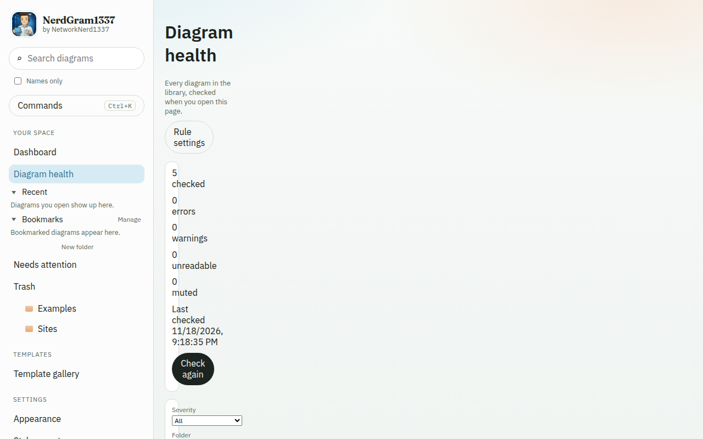
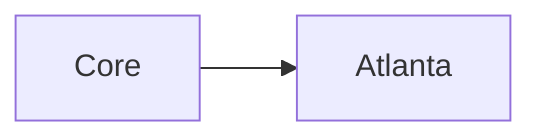

# Features

The dashboard lists folders and diagrams in a tree, with search and grid or list view.

[Back to the documentation index](README.md)

## Contents

- [Preview](#preview)
- [Editing](#editing)
- [Files](#files)
- [Trash and history](#trash-and-history)
- [Titles, themes, and notes](#titles-themes-and-notes)
- [Style presets](#style-presets)
- [Appearance](#appearance)
- [Diagram checks](#diagram-checks)
- [Linked diagrams](#linked-diagrams)
- [Thumbnails, find, and shortcuts](#thumbnails-find-and-shortcuts)
- [Search](#search)
- [Presentation](#presentation)
- [Template gallery](#template-gallery)
- [Syntax reference](#syntax-reference)
- [Generate from data](#generate-from-data)

The dashboard lists folders and diagrams in a tree, with search and grid or list view. You can create, rename, and delete folders and diagrams. Delete moves them to trash. Bookmarks are stored in `<data>/.meta/favorites.json` and return when you restore a diagram from trash. An older favorites list in that same file is kept. The paste flow is `/new`, and it uses the same folder picker as move and import.

Paths in this document use two placeholders, always in code formatting so GitHub does not treat the angle brackets as HTML tags. `<data>` is the data directory: `NERDGRAM_DATA_DIR` when that variable is set, and `diagrams/` inside the project when it is not. `<repo>` is the project folder, the git clone or the extracted ZIP.

The editor is split code and live preview, with autosave about **500 ms** after you stop typing and an **Auto-Update** preview. The code pane has Mermaid syntax highlighting, autocomplete (diagram types, keywords, arrows, snippets, and existing node IDs), bracket matching, and inline parse errors. A long file scrolls inside the code pane, and the view follows the caret. A parse error underlines the line and column Mermaid reported, and the last diagram that rendered stays on screen, marked out of date. Export from the editor is SVG, PNG, JPG, or PDF, and a lab or inventory file under **Lab and automation**. That group is enabled when the diagram has network JSON beside it. When it does not, the entries stay visible and disabled, and the menu says to generate the diagram from data. If that export returns warnings, a dismissible note lists them after the download. No warnings means no note. Each one uses the diagram's theme and background, the same colors you see in the editor. PNG can be saved transparent from the export menu. PNG, JPG, and a PDF that is drawn from the picture scale down from 2× when that canvas would pass the browser's size limit, and a note says the scale that was used. SVG and PDF are drawn again with SVG text labels so the words are in the file, not only in an HTML label. If that PDF cannot be built, the PDF is the same picture as the PNG. The API and the CLI render SVG or PNG only. [Diagram checks](#diagram-checks) lists the warnings and the quick fixes.

## Preview

The preview pane shows the diagram from the file. Drag anywhere on the picture to pan. The mouse wheel zooms toward the pointer. A trackpad pinch zooms, and a two-finger scroll pans. **Fit** on the preview toolbar puts the whole diagram back in the pane and clears the pan. The percent next to it is the zoom. Typing in the code pane does not reset that view.

Drag the divider between the code pane and the preview to give either side more room. The preview fits again as the pane changes size, while you are still on the fitted view. Double-click the divider to put the split back. The choice is saved in this browser when you drag it or move it with the keyboard. Resizing the window only clamps what you see, and the saved split comes back when there is room. The divider is a separator: arrow keys move it when it is focused, and the value it reports is a whole number. A narrow window stacks the panes and hides the divider.

The toolbar still sets the diagram theme, look, and layout, and it still has **Present**. At a desktop width, 1280 pixels and wider, those controls stay on one row. **Diagram info** in the editor header opens and closes the info panel. Those controls are not part of the pan. Text outside the preview, including the code pane, still selects as usual.

A flowchart node keeps the same inner padding when a line is a long address, such as `2001:db8::1/128`. The preview, presentation, and SVG and PNG exports all do this, in the light and dark themes. A label that already has a line break still shows every line. Edge labels are unchanged. A file that sets `flowchart.wrappingWidth` keeps that width.

## Editing

The editor header is the folder path: **Local files**, then each folder, then the file name without `.mmd`. Each folder is a link to that folder on the dashboard, and **Local files** returns to the dashboard root. Click the file name, or run **Rename file** from the command palette, to rename the file in place. That does not change the front matter title, and renaming the title does not rename the file. Unsaved edits are saved first. The editor that holds the lock can rename the open file. The address changes to the new path, the editor stays on that file, and edits that were not saved yet stay in the editor. A second window that has the same diagram open is still told it is open elsewhere. A long path collapses the middle folders to an ellipsis, and the tooltip is the full path. The logo leaves the editor for the folder that contains the diagram. A diagram at the root returns to the dashboard root. If that folder is gone, the link opens the nearest folder that is still there. The browser tab is the diagram name, for example **Campus · NerdGram1337**. Renaming the file updates it. Other pages name themselves the same way: **Dashboard · NerdGram1337**, **Diagram health · NerdGram1337**, **Settings · NerdGram1337**, and the page you are on. The browser Back button is unchanged. **Diagram info** in that same header toggles the info panel. It stays marked while the panel is open. The command palette command **Edit diagram info** still opens the panel.

Opening a diagram takes a lock for that browser tab. Another tab, or a second NerdGram process pointed at the same data directory with a different `PORT`, can open it read-only and is told that it is already open. The editor sends a heartbeat every **15 seconds**. If the heartbeat is missing for **90 seconds**, or the server process that held the lock has exited, the lock is stale. The read-only banner then offers **Take over editing**. After you confirm, that window takes the lock. A window that is still sending heartbeats keeps the lock, so two editors do not write the same file. Closing the tab, or leaving the editor, releases the lock with a beacon the browser can deliver while the page is going away. If that release does not arrive, the lock still expires on the heartbeat timer. These locks are not accounts, and they do not stop you from editing the `.mmd` file in another program.

Each save sends the modification time and a content hash from the last time this editor loaded or saved the file. If the bytes on disk are different, autosave stops. You can reload the disk copy, overwrite the disk with your copy, or keep your copy without saving. Overwrite stores the disk copy as a revision first. Creating a diagram does not need a baseline. Saving over a file that already exists does: a second write with no baseline is refused, so a new diagram will not silently replace one that is already there.

From the dashboard, you cannot rename, move, or trash a diagram, or a folder that contains it, while an editor still holds its lock. Close that editor first. The editor that holds the lock can rename the open file from its header.

## Files

**Move to…** is on every diagram and folder, next to Rename and Delete. It opens a folder list, including the workspace root. Arrow keys move through that list. You can also drag the item onto a folder in the dashboard or the sidebar tree. The Dashboard item at the top of the sidebar is the workspace root. Trash is not a drop target.

A folder card counts the diagrams and folders directly inside it, for example **0 diagrams · 2 folders**. A folder with no subfolders shows only the diagram count. The count is not a total of everything nested further down. The same line is used in every folder you open.

**Your space** in the sidebar is, from top to bottom, Dashboard, Diagram health, Recent, Bookmarks, Needs attention, Trash, then a **Folders** heading and the folder tree. The heading keeps those folders from looking like they sit inside Trash. Recent is the last 10 diagrams opened in this browser. It is stored in the browser, not on the server. A rename or move keeps the row. A deleted or trashed diagram drops off. **Clear** empties the list. Bookmarks are the old favorites, with folders that can sit inside other folders. The section collapses, and the list scrolls inside a fixed height. A row is one line, the file name, with the full name on the tooltip. The sidebar and **Settings → Bookmarks** show the folders as a tree. A folder expands and collapses, and a folder inside another is indented the same way as the diagram tree. **New folder** adds one at the top and lines up with the other sidebar actions. **New subfolder** adds one inside the folder you have open. **Actions** on a bookmark or a bookmark folder opens over the list, so the other rows stay put. With one menu open, one click on another row's **Actions** switches to that menu. Escape closes it and returns to the button. The menu has Up, Down, Move, Rename, Delete, and Remove, so the name keeps the width. Move lists nested folders as a path, such as `Sites / Lab`. Up and Down reorder within the same folder. You can also drag a bookmark to reorder it, or to drop it into a folder at a chosen spot. A line shows where it will land. The line is drawn over the list, so the row under the pointer stays put, and no line is drawn when the item would stay where it is. While a bookmark is dragging, the list does not change height. The top level and each folder, including one that is empty or collapsed, highlight with an outline when the bookmark is over them. The end of each list is a small drop area the whole time. The bookmark box scrolls when the pointer is near its top or bottom. You can drag a bookmark folder in the sidebar and in **Settings → Bookmarks**. Dragging a folder does not change the list height in either place. The middle of another folder's row nests the folder you are dragging, and that row highlights. The top or bottom edge of the row reorders it among the folders beside it, and the same line shows where it will land. Dropping it on the top level, outside a folder, moves it back to the top. A drop on the folder itself, or on a folder inside it, is refused and does not highlight. **Actions → Move…** still moves a folder from the keyboard. **Manage** opens `/settings#bookmarks`. Deleting a bookmark folder keeps its bookmarks and the folders inside it, and moves them up to that folder's parent. A folder at the top level still sends them to the top level. Moving a folder into itself, or into a folder inside it, is refused. An older bookmarks file that has no parent on a folder still loads. A parent that is missing is treated as the top level. A bookmark whose file is gone is marked Missing and can be removed. Needs attention opens a dashboard list of diagrams with check problems, broken links, or files that could not be read. The badge counts those diagrams, not each problem. A row says how many errors and warnings that diagram has, for example **1 error · 2 warnings**. The count is hidden when nothing needs attention. It uses the same workspace check as Diagram checks, and that check runs again after the workspace changes. It does not poll. A warning that is muted on that diagram is left out of the list and out of the count. An error is not.

Drag the divider between the sidebar and the page to widen or narrow the sidebar. The main area takes the space that is left. The divider matches the editor split: the pointer is a column resize, a hover shows the grab, and the drag does not select text. The width stays between 200 pixels and the smaller of 560 pixels and half the window. Double-click, Home, or Enter puts it back to 280 pixels. Arrow keys move it when the divider is focused. The width is saved in this browser and kept across pages that use this sidebar, which are the dashboard, a folder, and Needs attention. A window that is too narrow for the saved width clamps what you see and does not replace the saved width. A narrow window, the same 960 pixel width that stacks the editor, stacks the sidebar and hides this divider. The editor's code and preview split keeps its own saved ratio. Presentation does not use this divider.

In the sidebar, a folder that contains another folder has a chevron. The chevron expands or collapses that branch. The folder name still opens the folder. Folders with no subfolders have no chevron, and the names stay lined up. **Expand all** and **Collapse all** sit together above the tree when any folder contains another folder. **Expand all** opens every branch. **Collapse all** closes every branch except the folders you need to see the one you have open. The choice is saved in this browser. Opening a folder expands the folders above it so the current one stays visible. A button that would change nothing stays visible and is marked disabled.

A move that would land in the item's current folder, or put a folder inside itself or one of its subfolders, is refused. Dragging onto a diagram does nothing. If the destination already has that name, the drag is refused and nothing is overwritten. Move to… offers **Move as Name (copy)** (then **Name (copy 2)**, and so on). Bookmarks and revision history follow the file or folder.

**Duplicate** copies a diagram or a whole folder. The first copy is `Name (copy).mmd` (or `Name (copy)` for a folder), then `Name (copy 2)`. It never overwrites an existing item. The copy is not favorited, it does not share the source's editor lock, and it starts with no revision history. Hidden files, including anything under `.meta`, are not copied. If the diagram was generated from a data file that sits next to it, duplicate asks whether to copy that file or keep sharing the original. Copying writes `Name (copy).csv` (or `.json`, `.network.json`, `.cdp`, `.lldp`, `.route`, and an edges file when there is one) and points only the duplicate at it. Sharing leaves both diagrams on the original file. The original file is left unchanged either way.

Renaming or moving a diagram asks first when other diagrams link to it, then updates those `click` targets and lists the files it changed. A relative link inside a diagram that moved is updated too, so it still points at the same file. A data file that sits in the same folder moves with the diagram, and `nerdgram.source` is updated so **Refresh from data** still finds it. Renaming `Campus.mmd` to `Core.mmd` also renames `Campus.csv` to `Core.csv` and `Campus.lldp` to `Core.lldp`. A data file that lives in a different folder stays where it is. If another diagram already shares that file, the move copies it for the diagram that left and leaves the original bytes in place. A rename or move made outside the app does not do this by itself. **Repair links** can fix the `click` targets after you confirm a preview, and it updates `nerdgram.source` when the data file moved with the diagram. See [Linked diagrams](#linked-diagrams).

**Import** copies a diagram into the folder you are viewing, or into a folder you pick. Use **Import**, or drop a file onto the dashboard or a folder. The button says `Mermaid: .mmd, .mermaid, .md, .markdown, .txt`. A line under the toolbar lists the same supported files. The app looks at the contents, and uses the extension only as a hint. Mermaid is stored as `.mmd`, including a `.txt` paste and a Markdown file that contains a `mermaid` fence. CSV, JSON, Cisco CDP, LLDP, a Cisco `show ip route` paste, and `.network.json` open in **From data**. A NerdGram style-preset JSON file opens in **Style presets**. Lucidchart (including a pages export whose shapes and lines are arrays or id-keyed objects, with block shape names and `from`/`to` lines), draw.io, Visio, PlantUML, Graphviz, D2, Excalidraw, SVG, PNG, JPEG, and PDF are named and left as not supported yet. Anything else says it is not a recognized format. Those messages list the supported types and link to From data. Each file can be up to 512 KB, with at most 25 files and 3 MB of text in one import. A dropped folder is not imported as a tree.

If a name is already in that folder, choose **Skip**, **Rename** (`Name 2.mmd`, then `Name 3.mmd`), or **Replace**. Nothing is overwritten unless you choose Replace. Replace keeps the previous text as a revision. A diagram that is open in an editor is not replaced. If Mermaid cannot parse a file, the dialog warns you and still lets you import it. The imported file is a normal diagram, not a link back to the original path.

## Trash and history

Delete moves a diagram or a folder into the trash. It does not erase the files. If other diagrams link to it, the app lists those files and asks you to confirm before the move. The links become broken-link warnings; they are not deleted for you. If a data file sits next to the diagram, delete asks whether to move that file to the trash too or leave it in the workspace. Trash takes the data file with the diagram, and restore puts it back beside the diagram. Keep leaves the file where it is. **Trash** in the sidebar restores an item or deletes it permanently. **Empty trash** removes everything in the trash for good.

Restore puts the item back at its original path. If something is already there, the app asks you to restore a copy (`Name (restored).mmd`, or `Name (restored 2)` and so on) or to replace the current item. Replacing moves that current item to the trash first. A folder is one trash entry. Restore puts the whole folder back.

Bookmarks come off the sidebar while an item is in the trash and go back when you restore it. If you restore to a different path, the bookmark follows that path. A move or rename does the same.

Every save that changes a diagram keeps the previous contents as a revision. **History** in the editor lists those revisions, shows the old text, and can restore one. Restoring writes the text you are replacing into history first. The last **20** unnamed revisions are kept for each diagram. Older unnamed ones are dropped. There is no age limit. Rename, move, and trash carry that history. Permanently deleting an item deletes its history. A duplicate starts with no history, including no baselines.

A revision can be given a name and an optional note, such as `Baseline - pre-change CHG-1234`. **Save baseline** stores the current saved diagram under a name even when nothing has changed since the last save. Named baselines are not dropped by the 20-revision limit. Each diagram keeps up to **20** named baselines (`NERDGRAM_BASELINE_CAP`, a whole number from 1 to 200; anything else stays at 20). At the limit, saving another baseline is refused with a message that states the number and says to remove one first. Removing a name puts that revision back under the 20-revision limit, and an older one can then be dropped. The name, note, and the time it was named live in the same `.meta` revision index as the rest of history. They follow rename, move, and trash, and they are deleted with the history on a permanent delete.

**Compare** in History shows what changed between two revisions, or between a revision and the current diagram. **Compare with baseline** starts from a named one. The compare window stays within the screen, about 90% of the window height, including when the window is not maximized. The title, From and To, and the Merged, Side by side, and Text choices stay put. Export and **Back to history** stay at the bottom. The comparison itself scrolls inside that frame. From, To, the picture, and the Save baseline Name and Note fields follow the app theme in dark, light, and the default theme. Flowcharts get a node and edge diff. Other diagram types get the text diff, and the panel says so. The merged picture colours added items green, removed items red and dashed, and changed items amber, with a legend. Side by side scales each diagram to its column and uses those same colours. Text names the left column From (older) and the right column To (newer), with the version label and time, and colours added, removed, and changed lines the same way. Unchanged lines stay quieter. The summary lists the changes in words. Export writes an SVG, PNG, JPG, or PDF of the merged picture, or a Markdown summary. **Present** shows the same picture full screen. None of this writes the diagram. Restore is still the way to put an old revision back.

Delete, permanent delete, empty trash, and a reload that would close a presentation or drop unsaved edits ask in that same themed dialog. Escape cancels. Enter confirms. A destructive action uses the danger button. The reload warning does not.

History for scripts is on `/api`, and the same calls are on `/api/v1` with a bearer token. `GET /api/history?path=Welcome.mmd` returns `path`, `retention`, `baselineCap`, `baselineCount`, and `revisions`. Each revision's id is the field `id`, alongside `createdAt`, `mtimeMs`, `size`, `hash`, `name`, `note`, and `namedAt`. `name`, `note`, and `namedAt` are null when the revision is not a baseline. `POST /api/history/restore` expects `{"path","id"}`, and `id` is that revision id. A body that names `revisionId` instead is **400** (`path and id are required`). A save can return `revisionId` for the previous bytes it just archived. That value is a revision id, and the restore body still names the field `id`.

`GET /api/history/diff?path=Welcome.mmd&from=<id|name|current>&to=<id|name|current>` returns the text diff, front matter changes, and, for a flowchart, nodes and edges that were added, removed, or changed. `from` and `to` accept a revision id, a baseline name, or `current`. The response includes `summary`, `markdown`, and `visualSource`. `from` and `to` include `label` and `createdAt`, the revision time or the current file's modification time. `visualSource` is a Mermaid document for the coloured picture. It is not written to the file. `POST /api/history/baseline` with `{"path","name","note"?}` saves the current diagram as a baseline. Add `"id"` to name an existing revision instead. `PATCH /api/history/baseline` with `{"path","id"}` and `name` or `note` renames it or edits the note. `DELETE /api/history/baseline` with `{"path","id"}` removes the name. Mutating calls need `Content-Type: application/json`. The same paths are under `/api/v1` (`/api/v1/history`, `/api/v1/history/diff`, `/api/v1/history/baseline`). Listing and diff need a read token. Creating, renaming, and removing a baseline need a read-write token.

```bash
curl -fsS -X POST "http://127.0.0.1:8787/api/history/restore" \
  -H "Content-Type: application/json" \
  -d '{"path":"Welcome.mmd","id":"REVISION_ID"}'
```

The file you edit stays a plain `.mmd` file. Bookkeeping lives under the data directory:

- `.meta/trash/items/<id>/` — one soft-deleted file or folder, plus the bookmarks and revisions that belonged to it
- `.meta/versions/p_<encoded-path>/` — the previous contents of one diagram
- `.meta/locks/p_<encoded-path>.json` — the editor lock for one path
- `.meta/style-presets.json` — named style presets and the optional default for new diagrams. The values are copied into each diagram. The preset file is not a diagram.

## Titles, themes, and notes

A diagram can start with [Mermaid's YAML front matter](https://mermaid.js.org/config/configuration.html). The title, theme, look, and layout are stored in the `.mmd` file, so they stay with it when you duplicate, import, or copy the folder.

```yaml
---
title: Network overview
config:
  theme: forest
  look: handDrawn
  layout: elk
nerdgram:
  description: Edge path into the lab
  tags:
    - network
  notes: |
    Draft for the lab write-up.
---
flowchart LR
  Internet --> Firewall
```

**Diagram info** in the editor edits the title, description, notes, and tags, and sets the theme, look, layout, and font. On a flowchart it also sets **Hub layout**. **Compact grid** or **Radial rings** is stored as `nerdgram.hubLayout` in the file. A hub with many leaf neighbors then draws roughly square in the preview, in Present, and in SVG and PNG export. Unset, the rank layout is unchanged. The tag field is a combobox. As you type, it suggests tags already used in the workspace, up to about eight. A prefix match comes before a match later in the word, and a more-used tag comes before a rarer one. Matching ignores case, and the matching letters are underlined. An empty field, once focused, lists the most-used tags. Tags already on this diagram are left out. Up and Down move through the list. Enter or Tab uses the highlighted tag. Escape closes the list. Enter or a comma with nothing highlighted adds the text you typed. When that text is not an existing spelling, the last row is **Create** followed by the text. If you type a different case of a tag that already exists, that existing spelling is the first suggestion, so `Firewall` offers `firewall` before a new variant. `GET /api/tags` returns each stored spelling and how many diagrams use it. Trash is not included. The same spelling on one diagram counts once, and `firewall` and `Firewall` stay two tags. The dashboard tag row uses the same suggestions to filter. The chips stay. The editor header has the same theme, look, and layout controls on the preview toolbar. **Diagram info** itself is the header button, not a second button on that toolbar. The preview, dashboard thumbnails, and the editor's SVG, PNG, JPG, and PDF export use the theme in the file. If the file does not set one, they use **dark**. [Appearance](#appearance) changes the app around the diagram. It does not change this theme.

Font family is a list: **Default**, **System UI**, **Sans-serif**, **Serif**, **Monospace**, and **Custom…**. Default clears `config.fontFamily` and the diagram uses the engine font. Custom is a CSS font list. It is saved when you leave the box or press Enter, and spaces between words stay. The fonts have to be installed on the computer that views or renders the diagram. Separate fallbacks with commas. A file that already names one of the presets opens on that preset. Any other value opens as Custom. Custom suggests families already stored on diagrams in this workspace. Theme variable color fields show swatches of colors those diagrams already use. **Save as preset** and **Apply preset** are in the same panel. [Style presets](#style-presets) describes both.

The built-in Mermaid themes are `default`, `neutral`, `dark`, `forest`, `base`, `neo`, `neo-dark`, `redux`, `redux-dark`, `redux-color`, and `redux-dark-color`. Looks are `classic`, `handDrawn`, and `neo`. Layouts are `dagre` and `elk`.

**New diagram**, **Paste Mermaid**, **From data**, and **Use template** ask for a **File name** before the `.mmd` file is written. The field starts empty. Paste Mermaid fills it from the front matter title, then a leading `%%` comment, then the first node label, and stops filling it once you type. An empty name is not saved as `Untitled.mmd`. If the folder already has that name, the page says so and offers the next free name, such as `Name 2`. Those screens also offer a style preset. New diagram, Paste Mermaid, and From data start on the default preset when one is set, and can choose **No preset**. Use template starts on **Keep template style**.

The editor header and the dashboard show the file name, without `.mmd`. A front matter title does not replace that name. When a title is set and it is not the same as the file name, the card shows it on a smaller second line. A title that matches the file name does not repeat. The rendered diagram and **Present** still use the title, as Mermaid does. A description is shown under the name. Tags are chips. Click a chip, or use the tag row, to filter the dashboard. Search matches the file name and the title, and also the description, notes, and tags. A file name match is listed before a title, tag, description, note, or label match.

Description, notes, and tags live under `nerdgram:` because Mermaid has no field for them. Mermaid still reads `title` and `config` from the same header. A diagram with no front matter previews the same way as before. An older `%%{init: ...}%%` line still renders. The editor can move that config into the front matter. If the header is not valid YAML, the editor shows the error and leaves the file text alone.

`%%` at the start of a line is a Mermaid comment. In the code pane, Ctrl+/ (Cmd+/ on a Mac) comments or uncomments the selected lines.

## Style presets

A style preset is a named copy of the style fields in Diagram info: theme, look, hand-drawn seed, layout, font family, theme variables, theme CSS, flowchart curve, ELK options (`mergeEdges` and node placement), and Gantt display. Title, description, notes, and tags stay on the diagram and are not part of a preset.

**Save as preset** in Diagram info stores the style of the diagram that is open. **Apply preset** lists what will change. **Apply** copies those values into the file's front matter. **Undo** puts that file text back. The file does not store the preset name or id, so editing or deleting a preset does not change diagrams that already used it. The diagram still renders the same way in GitHub or any other Mermaid tool. `config.flowchart.wrappingWidth` is not part of a preset. Applying one leaves that width as it is. A file that does not set it still uses the 480px default when the diagram is drawn. A file that sets its own width keeps that width.

Presets are stored in `<data>/.meta/style-presets.json`. That file is not a diagram. The folder tree, search, diagram checks, and trash skip it. GitHub sync does not copy it. **Style presets** on the settings page (`/settings#style-presets`), and in the sidebar, renames, duplicates, edits, and deletes a preset, and chooses the default for new diagrams. **Export JSON** downloads the list. **Import JSON** adds the presets in a file. Check **Replace the presets on this computer** to use the file as the whole list instead. Diagrams are not changed either way. The file is version 1. A field it does not recognize is rejected.

**New diagram**, **Paste Mermaid**, and **From data** start on the default preset when one is set. Each of those screens can choose another preset or **No preset**. **Use template** starts on **Keep template style**. Choosing a preset copies it into the new file and leaves the template itself alone.

`GET /api/style-presets` returns `version`, `defaultId`, and `presets`. `POST /api/style-presets` creates one from `name` and `style`. `default: true` makes it the default. `PUT /api/style-presets/<id>` changes `name`, `style`, or `default`. `DELETE /api/style-presets/<id>` removes it and, if it was the default, clears the default. `POST /api/style-presets/import` reads a version 1 document. `mode` is `add` or `replace`. Unknown fields are rejected. These routes are for this computer. They are not under `/api/v1`.

The command palette commands **Apply style preset** and **Save style as preset** open Diagram info on those controls.

When Font family is **Custom…**, the box suggests font families already stored in the workspace, with how many diagrams use each one. The list works like the tag field. A prefix match comes before a match later in the text, a more-used family comes first, and the matching letters are underlined. An empty box, once focused, lists the most-used families. Up and Down move. Enter or Tab uses the highlighted family. Enter with nothing highlighted saves the text you typed. Escape closes the list. A comma stays in the value, because a font list uses commas between fallbacks. `GET /api/fonts` returns each stored spelling and the count. Trash is not included. The same spelling on one diagram counts once. `IBM Plex Sans` and `ibm plex sans` stay two families.

Color fields under Theme variables show a row of swatches. Workspace colors come first, most-used first, then colors picked in this browser that are not already in that row. A swatch is a button. Arrow keys move between them. Enter or Space uses the focused swatch. `GET /api/colors` returns each color and how many diagrams use it. A color counts once per diagram. Trash is not included. `#fff` and `#ffffff` are the same swatch. Recent picks stay in this browser, not on the server.

## Appearance

**Appearance** on the settings page (`/settings#appearance`) is **Light**, **Dark**, or **Match system**. Match system is the default. The choice is saved in this browser. It is not an account, and it is not stored on the server.

The dashboard, sidebar, settings, dialogs, the reference, and the editor, including the code pane, follow that choice. The page is painted with the saved choice before the first frame, so a dark choice does not flash light. Match system follows the computer, including when the computer changes.

A diagram's theme, look, and layout stay in the file. Presentation uses that diagram theme, the same as before.

## Diagram checks

**Diagram health** (`/health`) is the library-wide check. Its link is in **Your space**, directly under Dashboard. The page uses the same sidebar width and divider as the dashboard, so the findings use the rest of the window. Opening the dashboard does not run the library-wide check. The page runs it when you open it, and **Check again** runs it again. A summary strip shows how many diagrams were checked, and the error, warning, unreadable, and muted counts, plus when the library was last checked. Filters narrow the list by severity, by folder, and by name. Findings are grouped by diagram. A line link opens the editor on that line. Groups collapse, and **Expand all** and **Collapse all** use the same control as the folder tree. **Repair links** is there when a diagram link is broken. Files that could not be read are listed in plain words. Muted diagrams are named without repeating the warning text. Before the first check the page says **Not checked yet**. When nothing is wrong it says **Every diagram looks good**. **Rule settings** opens `/settings#diagram-checks`, which is only the on/off switches for warning rules. Those switches stay in this browser. The sidebar link for them is **Check rules**, so it is not the results page.

The check keeps a memory cache. A second pass over an unchanged library does not re-read or re-parse the files. Editing one diagram parses that diagram again. Renaming or deleting a diagram updates broken-link findings from the click targets already parsed. An edit made outside the app, in a file manager or `git pull`, is seen on the next full check, and on the check that runs when the server starts, because the file's size or modification time changed. The cache is discarded when the process stops. It is not written under `.meta`. `GET /api/diagram-lint` returns `checked`, `relinted`, `durationMs`, and `cachedAt`. `relinted` is how many files were parsed on that pass. `GET /api/diagram-lint/summary` is what the dashboard reads. When diagrams were saved, renamed, moved, or deleted in NerdGram, that request re-parses only those files and patches the last result. It does not parse the rest of the library.

**Needs attention** does not run a library-wide check. It reads `GET /api/diagram-lint/summary`. Mute, unmute, and other edits show up on the next read, including after a reload, without opening Diagram health. If no check has run since the server started, the badge has no count and the view says **Not checked yet. Open Diagram health.** After a check, the badge is the number of diagrams in that list. A count of zero is shown only after a check that found nothing. While a refresh has not caught up yet, the view says diagrams have changed since the last check.

The code pane still checks the diagram you are editing. That check is not the library-wide pass.

**Mute warnings** on the problems list under the code pane hides that diagram's warnings. **Unmute** puts them back. The switch is there when the diagram has warnings, or when warnings are already muted. While they are muted, the editor shows **Warnings muted** and **Unmute**, and it does not show a warning count or warning marks in the code. The dashboard counts, Needs attention, and its sidebar count drop that diagram's warnings. `nerdgram lint`, `POST /api/lint`, and `GET /api/diagram-lint` omit them too. Other diagrams are unchanged. Errors are never muted. A muted diagram that gains a parse error still shows that error, and it still appears in Needs attention for the error. The open checks panel and Needs attention can say how many diagrams have muted warnings and name those files. They do not repeat the warning text.

The mute is a Mermaid comment, so the rendered picture does not change:

```text
%% nerdgram: warnings=muted
```

The editor writes that line near the top of the file, after the YAML front matter when the file has a header, and saves it like any other edit. Undo, history, and GitHub sync see it. Deleting the line unmutes. A rename or a move keeps the line because it is in the file. The mute is the whole diagram. It is not one warning, and it is not every diagram.

The code pane checks the diagram while you type. The check waits about **400 ms** after the last key so a large file does not lag. Mermaid's parser supplies the syntax error, including the line and column. Each problem shows that place once, as **Line N, column M:**. A broken settings block is only that one error. It says **Settings error** in the editor banner, the preview, the problems list, Diagram health, Diagram info, and Present. The tooltip names the settings block (front matter) and includes the parser message, the line, and the column. It is not also reported as invalid Mermaid. The other checks are warnings. They do not block the preview or autosave. A warning is a gutter mark and a row in the problems list under the code. Click a row to jump to that line. `nerdgram lint` runs the same checks on a file, or on the workspace when you point it at a running server. A Mermaid syntax error is reported as an error, with the line and column, and the command exits non-zero. `POST /api/lint` and `POST /api/v1/lint` do the same for one diagram. `GET /api/diagram-lint` and `GET /api/v1/lint` run the checks on the workspace.

The problems list can also offer a fix. **Rename** gives a duplicate id, or a class defined again with a different label, a new name. **Remove unused class** deletes a `classDef` nothing uses. **Create class** inserts a `classDef` for a name you already applied. **Declare class** and **Declare entity** insert the missing name. **Remove duplicate attribute** deletes the extra attribute line. **Remove duplicate** and **Remove empty node** delete a repeated or blank mindmap node, or a repeated or blank timeline event, when that line has no children. **Jump to definition** moves the cursor to the first definition of a duplicate id or class. Each of those can be undone with Ctrl+Z (Cmd+Z on a Mac). **Repair links** on a broken diagram link opens a preview of the rewrites. Confirming it saves the diagrams. Nothing is written before that confirmation.

Turn a warning off under **Check rules** on the settings page (`/settings#diagram-checks`). The sidebar links there on its own, next to Appearance, Style presets, Host, Diagram folder, Instance name, GitHub sync, and automation tokens. The switches are saved in this browser. A diagram Mermaid cannot parse is always marked. **Repair links** stays disabled when no renamed diagram matches a broken link.

| Rule | What it warns about |
| --- | --- |
| Duplicate ids | The same id is defined again with a different label. Flowcharts, sequence diagrams, and state diagrams. |
| Unconnected nodes | A flowchart node is defined but never used in a connection. A single node with no connections is left alone. |
| Unlabeled endpoints | A connection names a node that was never given a label. That is usually a typo. A link to a subgraph id is not a typo, including `subgraph ID`, `subgraph ID["Label"]`, `subgraph "Title only"`, and a subgraph inside another. A case-only mismatch, such as `SouthBound` against `Southbound`, still warns, and the message names the closest id when there is one. A flowchart that mostly uses bare ids, such as `A --> B`, is left alone, including when one extra node has a label. A dotted `-.->` link is a normal connector. |
| Unused classes | A `classDef` is never applied with `class` or `:::`. `classDef default` is treated as used. |
| Undefined classes | A `class` or `:::` name has no `classDef`. |
| Front matter | The YAML header cannot be parsed, or a theme, look, layout, curve, ELK placement, title, description, or tag list is not one the file format accepts. |
| Broken diagram links | A `click` target that points at a workspace diagram (`nerdgram:`, `diagram:`, or a relative `.mmd` path) is missing, or the path leaves the workspace. Web links are not checked. |
| Duplicate classes | The same class name is defined again with a different label. Repeating `class Animal` to add members is left alone. |
| Undeclared classes | A class diagram relationship names a class that was never declared with `class` or a member line. A diagram that only uses relationships, with no `class` statement and no member line, is left alone. |
| Duplicate attributes | An entity lists the same attribute name more than once. The same name on two entities is left alone. |
| Undeclared entities | An ER relationship names an entity that was never declared with an attribute block or a bare entity line. A diagram that only uses relationships is left alone. |
| Missing task ids | A Gantt task uses `after` or `until` with an id that no task defines. An id defined later in the file still counts. |
| Invalid dates | A Gantt date does not match the diagram's `dateFormat`, or is not a real calendar date. Durations such as `3d`, and `excludes weekends`, are left alone. A `dateFormat` this check does not understand is left alone. |
| Duplicate siblings | A mindmap repeats a label under the same parent, or a timeline repeats an event in one period. The same label under a different parent, or the same event in a different period, is left alone. |
| Empty nodes | A mindmap node or a timeline event has no text. An icon line (`::icon(...)`) is not a node. |

**Diagram health** is that list for the whole library. It is not a box on the dashboard. A thumbnail whose file could not be read still shows **Can't read file**, with the reason and **Retry**. A thumbnail whose diagram cannot be drawn shows a **Parse error** badge, and the card border is the same red as that badge. A diagram that still draws, but has error-level check problems, shows a red error count and the same red border. Warnings that are not muted show a yellow pill, such as **3 warnings**, and a yellow border. The yellow is the warning color already used for checks, and the pill text is dark in the light theme and the dark theme. Muted warnings add no pill and no yellow border. An error hides the warning pill. The card reads the workspace check summary, the same one Diagram health and Needs attention use. Opening the dashboard re-checks only diagrams that changed in NerdGram, so a mute or unmute updates the yellow pill without a library-wide check. A folder, a search result, and a list row use the same treatment. A header that cannot be parsed shows **Settings error** on the grid and in the list, with that same red border. Hovering the pill says the settings block at the top of the file (front matter) has an error, and it includes the line when the file has one. It does not say **Parse error**. **Parse error** stays the badge when Mermaid cannot draw the diagram, on the card and in the list. A syntax error is not shown as a count such as **1 error**. When the header is the only problem and the diagram body can still be drawn, the thumbnail draws the body and leaves the broken header out, so the card is not left on Preview unavailable. One unreadable diagram does not stop the server, the dashboard, search, sync, or link checks. The log names that file in one line, and those walks skip it. The diagram list, the tag list, and **Repair links** name it as unreadable and still return the rest. Opening the file itself, or asking for its thumbnail, still reports the error.



## Linked diagrams

A node can open another diagram. The link is Mermaid's own `click` line, so the file stays valid Mermaid. Outside NerdGram the target is an ordinary link. Inside the preview and in presentation, a `nerdgram:` path or a relative `.mmd` path opens that diagram.



A path such as `./Rack.mmd` or `../WAN.mmd` is relative to the diagram that contains the line. `nerdgram:Sites/Atlanta.mmd` is the same path counted from the workspace root, which is the data directory. The older `diagram:` prefix is accepted the same way. The strings are in the `.mmd` file, so GitHub sync copies them with the diagram and they still resolve after a pull.

The sample pair is `WAN.mmd` and `Sites/Atlanta.mmd`. Click Atlanta on the overview to open the site. The trail along the top of the preview, and again in presentation, is the path you took, for example **WAN > Atlanta > Rack 3**, with **Back** and **Forward**. Presentation keeps that drill-down in the same full-screen view.

**Link node to diagram...** in the command palette inserts the `click` line. On a `click` line, autocomplete offers the diagrams in the workspace. A missing target is a warning in the problems list. Clicking it shows that message on the current diagram instead of opening a blank page. **Diagram info** lists **Links to** and **Linked from**.

Renaming or moving a diagram inside the app rewrites the `click` lines that point at it. A rename from the file manager, `git mv`, or a GitHub sync pull does not, so those links break. NerdGram remembers the path and content hash of each diagram it has seen, in `<data>/.meta/diagram-sightings.json`. **Repair links** compares that memory with the files now on disk. A path that disappeared and a new file that appeared in the same gap are a match when the content is the same, or, if the content is not, when the file name is the same and only one file fits. The dialog lists every rewrite. When the data file moved into the diagram's new folder, the same confirmation updates `nerdgram.source`. Confirming it saves those diagrams the same way an edit does, including revision history. Cancel, a dry run, or a preview writes nothing. If two files fit equally well, both are listed and neither is chosen. The same preview is `GET /api/link-repairs`, `GET /api/v1/link-repairs`, and `nerdgram repair-links`.

Only `nerdgram:`, `diagram:`, and a relative `.mmd` path navigate inside the app. An `http` or `https` address opens in a new tab and does not keep a handle back to this window. `javascript:` and any other scheme are blocked. A path that would leave the data directory is blocked the same way as a file operation.


## Thumbnails, find, and shortcuts

Dashboard cards keep a thumbnail of each diagram. The first time a card is on screen, the app draws it. After that, the picture is saved under `.meta/thumbs` and reused until the diagram changes. Scrolling a large folder only draws the cards you are about to see. A diagram that cannot be drawn shows “Preview unavailable” and a **Parse error** badge, and the card border turns the same red. A broken YAML header is not that failure. The grid and the list both say **Settings error**, the border stays red, and the thumbnail still draws the diagram when the body can be drawn. Under the name, the card and the list row also say **Settings need a fix**. Hovering that pill names the settings block (front matter) and the line when one is known. A diagram Mermaid cannot parse says **Parse error** in the list, with the same red pill and red border as the card. Unmuted warnings show a yellow pill and a yellow border in both views. Muted warnings and a clean diagram stay plain. Those counts come from the workspace check in [Diagram checks](#diagram-checks), not from a separate check on each card. The rest of the grid stays up.

**Ctrl** below means **Cmd** on a Mac. Find and go-to-line apply while the code pane is focused. The command palette applies everywhere except during presentation.

**Ctrl+F** in the diagram preview, or in Present, finds a node by its name or id. An IP, platform, or interface matches when the diagram names a data file in its own folder (`.cdp`, `.lldp`, `.route`, `.csv`, `.json`, `.network.json`, or `.txt`). The picture usually shows hostnames only, so those values are read from that file and mapped back to the node. The read returns only the file named in `nerdgram.source.file`, in that same folder. `GET /api/file` still accepts only `.mmd`. A diagram with no data file does not match an IP. The match is centered, zoomed in, and outlined. **Next** and **Previous**, or Down and Up, move through the matches. Enter moves to the next one. **Esc** closes the box and leaves Present open. In Present the box sits in the top-right corner, including on a narrow phone, and does not take a column beside the diagram. The same Ctrl+F while the code pane is focused stays with the code editor's own find.

A diagram of about 200 nodes or more shows **Rendering 1,001 nodes…** with **Cancel** on the preview, in Present, and during export, before the draw starts. Mermaid draws on the page's main thread, so the elapsed time does not tick during that draw. Cancel during the draw is kept and applied when the draw returns: the picture is dropped, and the editor says the render was cancelled. That notice stays on top of a preview that was already drawn, and the next successful render clears it. Leaving Present with Esc, or leaving fullscreen, while a draw is still running does the same thing. A smaller diagram shows no overlay.

| Action | Keys |
| --- | --- |
| Command palette | Ctrl+K. The **Commands** button does the same thing when the browser takes the shortcut. |
| Find | Ctrl+F |
| Find next | Ctrl+G or F3 |
| Find previous | Ctrl+Shift+G or Shift+F3 |
| Close find | Esc, while the find panel is open |
| Select matches of the current selection | Ctrl+Shift+L |
| Go to line | Ctrl+Alt+G |
| Comment or uncomment | Ctrl+/ |
| Present | F5, or Ctrl+Shift+Enter |
| Address bar | Ctrl+L stays with the browser. The app does not bind it. |

The find panel can match case, whole words, or a regular expression, and it can replace one match or all of them in the open diagram. **Replace in all diagrams…** on that panel opens the workspace replace with the same search filled in. The editor does not change any other file.

On Windows, AltGr is reported as Ctrl+Alt. On a layout where AltGr+G types a character, Ctrl+Alt+G can type that character instead of opening Go to line. Use **Go to line** in the command palette.

The palette lists the actions already in the app: new diagram, paste, folder, import, generate from data, refresh from data, search, replace across diagrams, open, rename, move, duplicate, trash, restore, diagram info, apply style preset, save style as preset, link node to diagram, history, theme, export, present, find, go to line, templates, GitHub sync, About, and check for updates. Template, sync, and update commands do not add a shortcut. The app also leaves Ctrl+D for the browser bookmark and does not bind F11.

## Search

The sidebar search box matches file names and paths, titles, tags, descriptions, notes, and the visible text in a diagram: node and edge labels, subgraph titles, sequence messages, and similar labels. It does not match a diagram only because the file says `flowchart` or `sequenceDiagram`. Results show the matching text. Opening a result jumps to that line in the editor. The command palette uses the same search. **Names only**, under the search box, limits the dashboard to file names and paths. Diagrams in the trash are not included. The gallery has its own search. Dashboard search does not list the bundled templates.

**Replace across…** on the dashboard, and **Replace across diagrams…** in the command palette, replace text in more than one diagram. The default scope is every diagram. You can limit it to the current folder, with or without subfolders, and uncheck diagrams or individual matches in the preview. Match case, whole word, and regular expressions (including `$1` in the replacement) match the editor's find bar. The default search is the diagram body. **Include front matter** also searches the YAML header. Hidden files, `.meta`, the trash, and templates are never changed.

Nothing is written until you preview and then replace. The preview shows each match with the line before and after, and a total such as “23 replacements in 9 diagrams”. A long list shows the first matches and says how many were left out. Those unlisted matches are still replaced in a diagram you leave selected. After the replacement, each diagram is checked. One that would not parse, or that gains a new error, is unchecked. A diagram generated from a CSV, JSON, network JSON, CDP, or LLDP file warns that **Refresh from data** would overwrite the change. A match inside a node id, a `click` target, or a path is marked, because changing an id can break styles or links from other diagrams. The data file itself is not edited.

Replace saves each selected diagram the usual way, so the previous text is a revision first. Thumbnails, search, link sightings, and GitHub sync then update as they do for any save. A diagram open in an editor is skipped. A file that changed after the preview is skipped. The summary lists what changed and what was skipped. **Undo this replace** restores that batch and skips any file edited since. One diagram can also be restored from History.

`POST /api/replace/preview`, `POST /api/replace/apply`, and `POST /api/replace/undo` do the same work. Apply sends each file's preview hash and any match ids to skip. The same paths are under `/api/v1` (`/api/v1/replace/preview`, `/api/v1/replace/apply`, `/api/v1/replace/undo`). Preview needs a read token. Apply and undo need a read-write token. Mutating calls need `Content-Type: application/json`. `nerdgram replace` prints the preview. `--yes` applies it. See [docs/cli.md](cli.md).

## Presentation

**Present** shows the diagram on its own, using the theme, look, and layout stored in the file. The title is the front-matter title when the file has one, and the file name otherwise. The control bar can hide the title. Node labels use the same inner padding as the preview, including a long IPv6 address.

In the editor, use **Present** on the preview toolbar, press **F5**, or press **Ctrl+Shift+Enter** (**Cmd+Shift+Enter** on a Mac). **Present diagram** is also in the command palette. On the dashboard, the palette lists **Present:** and the diagram name next to **Open**. That opens `/present/` for that file. The browser tab reads **Present ·** the diagram name. **F5** is the browser reload key. NerdGram uses it for presentation only when a diagram is open and the cursor is not in a form field (search, rename, diagram info, go to line, or the command palette). It does work from the code pane. On the dashboard, the new-diagram page, and the reference, F5 still reloads the page. Ctrl+F5, Alt+F5, and Shift+F5 stay a reload. Pan and zoom keys do not run while you are typing in the editor. They run only during presentation.

**Esc** or **Exit** leaves presentation and returns to the editor or the dashboard. If the browser is showing its own fullscreen and blocks the first Esc, press Esc again or use **Exit**.

A linked node drills into that diagram without leaving full screen. **Back**, **Forward**, and the trail (**WAN > Atlanta > Rack 3**) move through the diagrams you opened. The control bar still hides until you move the pointer or press Tab. Leaving presentation returns to the diagram you started from.

On the dashboard, **Present** on a card or a list row opens that diagram without the editor. The address looks like `/present/Welcome.mmd`. Presentation does not save the file and does not take the editor lock. A template opens at `/templates/present/<id>` and is not copied.

The bar hides after about 2.5 seconds. Move the pointer, or press Tab, to bring it back. It has zoom in, zoom out, the zoom percent, rotate left, rotate right, fit, title, full screen, and exit. On a narrow window, about 520 pixels and below, the bar is one row under the diagram. Rotate, title, and full screen move into **More**. Fit uses the height above that bar. A wider window keeps every control on the bar, over the diagram.

**Fit** cycles the sizes that change the picture. **Fit page** shows the whole diagram. **Fit height** matches the height, up to 200%, and lets you pan sideways. That is the readable size for a wide diagram on a phone. **Fit width** matches the width, up to 200%, and lets you pan up and down. That is the readable size for a tall diagram. The first click leaves **Fit page** for whichever of those two shows more. **Fit** skips a mode that matches **Fit page**, and it skips one that would only stop at 200% without showing more than **Fit page**. The button name is the mode you are in. **0** or **F** still clears zoom, pan, and rotation and returns to **Fit page**.

On a phone, a pinch zooms around the point between your fingers. One finger pans once you have left the page fit, including after **Fit height** or **Fit width**. A double-tap switches between **Fit page** and 100% at the place you tapped. A mouse wheel, keyboard, and **Rotate** stay as they are on a desktop.

A very wide diagram in portrait shows a short note under the diagram: turn the phone, or use **Fit height** and pan sideways. **Dismiss** hides that note for the rest of this browser session. The note sits between the diagram and the bar, so it does not cover the picture.

| Action | Keys and pointer |
| --- | --- |
| Zoom toward the pointer | Mouse wheel, a trackpad pinch, or a two-finger pinch on a touch screen |
| Zoom toward the last pointer position, or the center | + or =, and - |
| Pan | Drag, one finger after you have zoomed, a trackpad two-finger scroll, W A S D, or Shift+arrow |
| Pan after you have left the fitted view | Plain arrow keys. At **Fit page** they do nothing, so a later slideshow can use them for the next diagram. **Fit width** and **Fit height** leave that fitted view, so the arrows pan. |
| Switch between fit page and 100% at the tap | Double-tap on a touch screen |
| Rotate 90° | R clockwise, Shift+R the other way. Alt+drag rotates by any angle. |
| Cycle the fit modes that change the size | **Fit** |
| Fit page, and clear zoom, pan, and rotation | 0 or F |
| Leave | Esc or **Exit** |

Zoom from the keys and buttons stays between 10% and 800% of the diagram's own size. **Fit page** can go outside that range so the whole diagram is visible. **Fit width** and **Fit height** stop at 200%, and they never go above 800%. A quarter turn uses the rotated size, so a tall diagram turned sideways fills a landscape screen. If fullscreen is unavailable, the diagram still fills the window. **Full screen** tries again after a click. A bad header or a diagram that cannot be drawn shows the error. The last good picture stays up when a later refresh fails. Animated fades are skipped when the system asks for reduced motion.

## Template gallery

**New diagram** on the dashboard, **Browse templates** on the Paste Mermaid page, **Templates** in the sidebar, and the command palette all open the gallery at `/templates`. The palette lists **Open template gallery** and **New from template:** plus each template name. Those commands do not add a shortcut.

The gallery is one section per category, in this order: Network, Software, Internet & Cloud, Security, OT & Industrial, Data Center, Operations & Planning, then User created. Each heading has a count and a collapse chevron. The open or closed choice is saved in this browser. Chips at the top jump to a section. Every category is shown, including one with no templates. An empty section says “No templates here yet.” User created also says to open a diagram and choose **Create as template**. A search or a type or tag filter hides sections with no matches. Choosing one category shows that section.

Each card shows a preview, the name, a short description, a category, and the diagram type. Search matches the name, description, tags, category, and diagram type. The category, type, and tag menus narrow the grid further. **Present** opens the template full screen without copying it. Shipped templates have no Edit, Rename, or Delete.

**Use template** asks for a **File name** and a folder. The folder list is the same picker used when you move a diagram. The app writes a new `.mmd` file and opens that copy in the editor. If the name is already there, the new file is `Name 2.mmd`, then `Name 3.mmd`. The existing file is left as it is. Editing the copy does not change the template.

**Create as template** in the editor, and the same command in the palette, saves a copy of the open diagram under User created. The original diagram is not changed. The dialog starts from the title, description, and tags. The category is always User created. A matching user template asks whether to rename or replace it. **Edit** opens that template in the editor. The header says **Editing template**, and the path reads Templates / User created / the name. Saving writes the template, not a diagram folder. **Rename** and **Delete** are on the card. Delete asks first and does not change diagrams already created from the template.

Shipped templates include a network topology and a home lab (Network), a flowchart and a sequence (Software), a firewall rule policy (Security), and a rack elevation (Data Center), plus starters for WAN, cloud, security, industrial, data center, and planning diagrams. Addresses in them are documentation ranges from [RFC 1918](https://www.rfc-editor.org/rfc/rfc1918) and [RFC 5737](https://www.rfc-editor.org/rfc/rfc5737).

Shipped files live in `templates/` at the project root, next to `reference/`. They are not in `diagrams/`, and they are not under `.meta`. To add a shipped template, drop a `.mmd` file in `templates/` and refresh the gallery. The file name is lowercase letters, numbers, and hyphens, such as `lab-wireless.mmd`. Files in subfolders are skipped. Start the file with Mermaid front matter: `title`, `config.theme` set to a built-in Mermaid theme, and a `nerdgram` block with `description`, `tags`, and `category`. The diagram has to be valid Mermaid or the preview shows “Preview unavailable.” No manifest is required. Put `category` in one of the section names above.

`templates/` is part of the app. The image copies that folder in and leaves it read-only, the same way it copies `reference/`. User templates are `<data>/.templates/<id>.mmd`. The dashboard, trash, and search skip that hidden folder. They stay on the data volume across a container rebuild. GitHub sync does not copy hidden paths, so user templates stay on this computer. `POST /api/templates` creates one from diagram content or a workspace path. `PUT /api/templates/:id` saves it. `POST /api/templates/:id/rename` renames it. `DELETE /api/templates/:id` deletes it. A shipped id answers **403**. `nerdgram template save <diagram>` and `nerdgram template rm <id>` do the same on this computer. They do not call the API. `--replace` overwrites a user template with the same id.


## Syntax reference

NerdGram1337 ships a local mirror of the Mermaid diagram syntax docs so you can look up syntax with no internet connection. In the sidebar, **Open Syntax Reference Library**, or the same link in the editor top bar, or the command palette entry, opens `/reference` in a new tab. The dashboard or editor stays where it was.

- Bundled mirror: `reference/manifest.json` and `reference/pages/*.md`, checked into the repo and copied read-only into the image.
- When `NERDGRAM_DATA_DIR` is set, a sync writes to `<data>/.meta/reference`. Reads use that copy when it has a manifest, and the bundled tree otherwise.
- When `NERDGRAM_DATA_DIR` is unset, sync replaces `reference/` at the repo root.
- Local annotations: `diagrams/.meta/syntax-overrides.json`, or `<data>/.meta/syntax-overrides.json` when `NERDGRAM_DATA_DIR` is set. These notes are per page and are not part of the replace.

While online, **Sync Syntax Reference** on the reference page fetches [the Mermaid syntax reference](https://mermaid.js.org/intro/syntax-reference.html) and the linked `/syntax/*.html` diagram pages, rebuilds the mirror in a staging folder, then replaces the live copy. The sync rewrites a few retired Mermaid URLs, including the old Getting Started page, onto the current docs pages so they are not copied back in. A successful sync updates `lastSyncedAt` in the manifest. A failed sync leaves the existing copy in place and the UI shows the error. From the project root:

```bash
npm run sync:reference --prefix server
```

Mirrored content is from the Mermaid documentation (MIT License). Each page keeps attribution and a link back to its source on [mermaid.js.org](https://mermaid.js.org/).

## Generate from data

**From data** on the dashboard, and **Generate diagram from data** in the command palette, open `/generate`. The source list adds each installed translator beside CSV, JSON, network JSON, CDP, LLDP, and a Cisco routing table. A routing-table paste uses the same 4 MiB limit as the other sources. Prefixes that share a next hop collapse to one edge. Hosts from ARP and a MAC table can be drawn on ports or as counts. The list is loaded from the server. A note above the input says the diagram reflects that export, and **Don't show again** hides it for that translator. The steps are in [Generate from data](generate-from-data.md). The field tables are in [Translators](translators.md).

## See also

- [Generate from data](generate-from-data.md)
- [GitHub sync](github-sync.md)
- [Configuration](configuration.md)
- [Upgrading](upgrading.md)
- [nerdgram command](cli.md)
