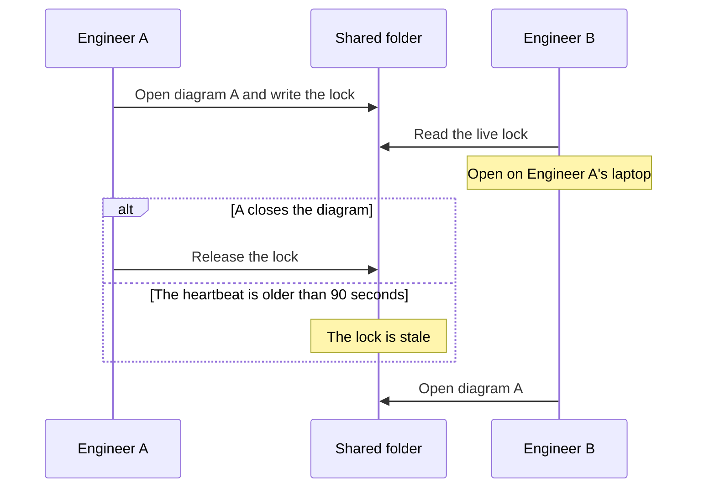

# Team use

NerdGram has no accounts and no roles.

[Back to the documentation index](README.md)

## Contents

- [Shared hub](#shared-hub)
- [Shared folder](#shared-folder)
- [Synced folders](#synced-folders)
- [GitHub sync](#github-sync)
- [Locks, heartbeats, and names](#locks-heartbeats-and-names)
- [Two engineers and one diagram](#two-engineers-and-one-diagram)

Paths in this document use two placeholders, always in code formatting so GitHub does not treat the angle brackets as HTML tags. `<data>` is the data directory: `NERDGRAM_DATA_DIR` when that variable is set, and `diagrams/` inside the project when it is not. `<repo>` is the project folder, the git clone or the extracted ZIP.

NerdGram has no accounts and no roles. Two or three engineers can still share diagrams. Use one of the three setups below. GitHub sync is the one to use when the cloud is allowed. The shared folder, with the instance-aware locks described here, is for a team that has to keep diagrams on local or on-premises storage.

## Shared hub

One NerdGram process listens on the LAN. Set Host to that machine's address, or to `0.0.0.0` or `::`, and open a browser at that address. [Configuration](configuration.md#configuration) has the bind, the Host allow-list, and the restart note. Everyone shares that one process. The editor lock is the lock that was already there: a second browser on the same server is "another window on this computer". The save still checks the file hash, so a diagram that changed on disk opens the usual conflict.

What this protects: a live lock inside that one process, and the save-conflict check.

What this does not do: it does not keep working when that computer is off, and it is not a copy on each laptop.

## Shared folder

Each engineer runs their own NerdGram. Set Diagram folder to the same directory on a share (SMB or NFS). That box sets `NERDGRAM_DATA_DIR`. The value is stored in the instance startup config, `~/.nerdgram/instance.json`, which is not on the share. On the next start, `getDataRoot()` reads it through `NERDGRAM_DATA_DIR`. If the shell, a service file, or Docker already set `NERDGRAM_DATA_DIR`, the box shows that value read-only and names the source. Docker stays read-only: change the volume mount.

Host is stored in that same instance file, not under `<data>/.meta/`. Changing Host on one computer does not change the others. An older `<data>/.meta/listen-host.json` is copied into the instance file once, when that file has no Host yet, and is then left in place and ignored. Saving Host and Diagram folder, then restarting once, applies both.

Each install creates an instance id the first time it starts and keeps it in that same file. Instance name defaults to the hostname. Set a friendlier name on the settings page, such as "Ryan's laptop". The name applies the next time a diagram is opened. It does not need a restart.

A lock file in `<data>/.meta/locks/` records `instanceId`, `instanceName`, and `hostname` along with the session, token, pid, and heartbeat. Older lock files that lack those fields still open. The pid check runs only when the lock's instance id is this install. A lock from another instance stays live until its heartbeat is older than 90 seconds, even when that pid does not exist on this computer. The editor heartbeats every 15 seconds. Take over stays available only after the lock is stale, the same as it is today. The second instance shows who has the diagram: the diagram name, the instance name, the hostname when the two differ, and the time it was opened.

The hash check is unchanged. A save that lost a race still reports that the file changed on disk.

What this protects: a live "open on another instance" lock across installs that share the folder, and the existing save-conflict check.

What this does not do: it does not merge two edits. The share has to report new and removed files promptly. Use a share that does not heavily cache file metadata. A stale cache can hide a lock that was just written, or keep showing a lock that was released. A folder that syncs after the fact is not this setup. See [Synced folders](#synced-folders).

## Synced folders

Team locks need a folder that every instance reads at the same moment. That folder is an SMB or NFS share, as in [Shared folder](#shared-folder).

iCloud Drive, OneDrive, Dropbox, and Google Drive are not that kind of folder. They copy files after the fact. A file can stay a download-on-demand placeholder, and two computers can each write a conflict copy. A lock file can arrive late, or not at all, so the lock is not reliable. A read can also fail while a placeholder is still downloading. Those services are not supported for team use.

To share diagrams through the cloud, use [GitHub sync](#github-sync).

**Can't read file** on a dashboard card, or the same words in the editor, means NerdGram could not read that diagram. It is not a Mermaid parse error, and it is not a lock. The sentence under it says why, for example that the file may still be syncing or that this computer cannot read the folder. Wait for the sync to finish, or mark the folder always available offline, then choose **Retry**. On a share, check that the share is connected. The Diagram checks panel names the file in the same words, and the other diagrams are still checked.

## GitHub sync

Each instance has its own copy of one repository. GitHub sync does not grow a live "open elsewhere" lock between instances. GitHub, pull, and the conflict screen that is already in the app handle history. This is the recommended setup when the cloud is allowed. Use the shared folder when the diagrams have to stay on local or on-premises storage.

If two engineers change the same diagram before either one syncs, NerdGram's existing conflict screen appears at pull or sync time and asks which version to keep. That is uncommon. Nothing in the lock code changes for it, and GitHub sync's conflict model is the same as it was.

What this protects: history, and a choice when both copies changed.

What this does not do: it does not stop both people from editing at once, and it does not say who has the diagram open.

## Locks, heartbeats, and names

The holder is written into the lock when the diagram is opened, and refreshed on the heartbeat. A second instance that tries to open, edit, rename, move, or delete the diagram gets **423** with that holder's instance name, hostname, `acquiredAt`, and `heartbeatAt`. `nerdgram` prints the holder in the error. The read-only editor asks again on the heartbeat with `poll: true`. While the lock is still held, that request answers **200** with `held: true` and the same lock fields, so the browser does not log a **423** on every retry. Opening the diagram the first time still answers **423**. Take over replaces the lock only after it is stale. Closing the diagram removes the lock. A crashed process on this computer drops its own lock immediately, because the pid is gone. A lock from another computer waits out the 90 second window, because this computer cannot see that pid.

Set the instance name under **Instance name** on the settings page. Blank means the hostname. The id, the name, and the Host live in `~/.nerdgram/instance.json` (or `NERDGRAM_INSTANCE_FILE`). They are not copied onto the share, and GitHub sync does not upload `.meta`, so locks stay local to the folder that holds them. In Docker the image user's home is `/tmp`, so the file is `/tmp/.nerdgram/instance.json` unless `NERDGRAM_INSTANCE_FILE` is set. It stays off the diagram volume. A new container is a new instance. The image's `HOST=0.0.0.0` still chooses the bind.

Host and Diagram folder both apply on the next start. The restart note shows only while the saved value differs from the value this process started with. After a restart that is running the saved value, the note is gone. NerdGram does not restart itself. Saving both settings, then restarting once, applies both.

## Two engineers and one diagram

Engineer A's instance and Engineer B's instance both use one shared folder. A opens diagram A. The lock is written with A's instance name and hostname. B opens the same diagram, sees the live lock, and gets "open on Engineer A's laptop". B can read it and can take over only after A closes it or the heartbeat goes stale. Then B can open it.

## See also

- [Configuration](configuration.md)
- [GitHub sync](github-sync.md)
- [Troubleshooting](troubleshooting.md)
- [Security model](security.md)
