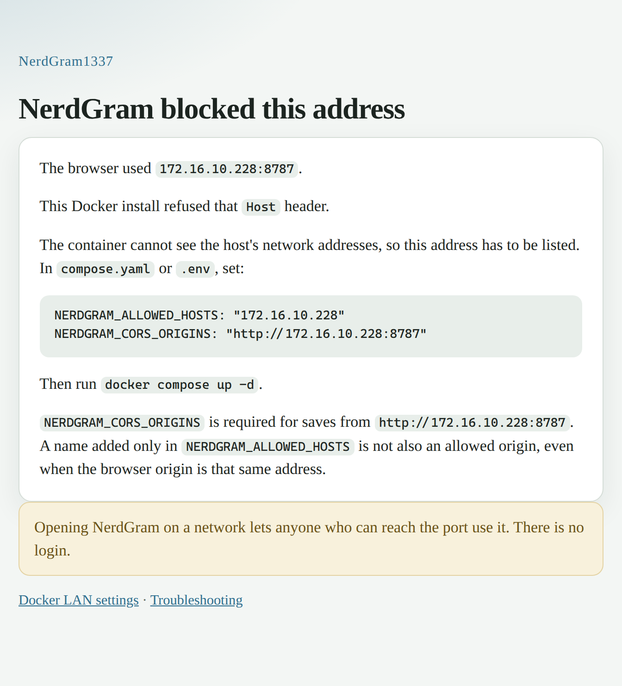

# Troubleshooting

If the API port is taken, the server exits and prints the listen error.

[Back to the documentation index](README.md)

## Contents

- [Port already in use](#port-already-in-use)
- [Wrong Node.js version](#wrong-nodejs-version)
- [npm cannot find package.json](#npm-cannot-find-packagejson)
- [npm start cannot find server/dist/index.js](#npm-start-cannot-find-serverdistindexjs)
- [The page opens, but diagrams do not load](#the-page-opens-but-diagrams-do-not-load)
- [Can't read file](#cant-read-file)
- [A save returns 403 or 415](#a-save-returns-403-or-415)
- [The browser says NerdGram blocked this address](#the-browser-says-nerdgram-blocked-this-address)
- [The container exits immediately, or the volume looks empty](#the-container-exits-immediately-or-the-volume-looks-empty)
- [localhost opens the dev UI, and 127.0.0.1 does not](#localhost-opens-the-dev-ui-and-127001-does-not)
- [Corporate TLS inspection](#corporate-tls-inspection)
- [A render returns 503](#a-render-returns-503)
- [About shows no version](#about-shows-no-version)
- [The data folder is synced, read-only, or not writable](#the-data-folder-is-synced-read-only-or-not-writable)

## Port already in use

If the API port is taken, the server exits and prints:

```text
Error: listen EADDRINUSE: address already in use 127.0.0.1:8787
```

A previous `npm run dev` or `npm start` is usually still running in another terminal. Switch to that terminal and press Ctrl+C, then start the app again. Do not run `npm run dev` and `npm start` at the same time. They both listen on 127.0.0.1 port 8787. A container published on that same host port collides with them too.

If Vite's port is taken, it does not exit. It prints:

```text
Port 5173 is in use, trying another one...
  ➜  Local:   http://localhost:5174/
```

Open the URL in that line. The API still has to be on port 8787, because the dev proxy forwards `/api` to `http://127.0.0.1:8787`. Saving a diagram from that fallback port needs the new origin on the allow-list. Stop the app, then start it again with `NERDGRAM_CORS_ORIGINS` set to the origin Vite printed. macOS or Linux: `NERDGRAM_CORS_ORIGINS=http://localhost:5174 npm run dev`. Command Prompt: `set NERDGRAM_CORS_ORIGINS=http://localhost:5174`. PowerShell: `$env:NERDGRAM_CORS_ORIGINS = "http://localhost:5174"`. Add `http://127.0.0.1:5174` in the same comma-separated list if you open the UI that way. Do not set a wildcard.

## Wrong Node.js version

Run `node -v` in the same terminal you use for `npm run dev`. It needs to be 20 or newer, and `npm -v` needs to be 10 or newer. If the commands are not found, or the numbers are too low, install Node.js 20+ from [https://nodejs.org/](https://nodejs.org/), then open a **new** terminal and check again. An old terminal can keep using the previous install. Docker uses the Node 22 image and does not use the host Node, except for the optional `node -p` in the build argument.

## `npm` cannot find `package.json`

```text
npm error enoent Could not read package.json
```

The terminal is not in the project root. `cd` into the folder from [Node.js](install.md#nodejs). `ls` or `dir` should show `package.json`, `client`, and `server` before you run npm.

## `npm start` cannot find `server/dist/index.js`

The production build has not been created. From the project root run `npm run build`, wait until it finishes, then run `npm start`.

## The page opens, but diagrams do not load

`npm run dev` has to keep both the `server` and `client` processes running. If you started only the client, the page has no API. Stop it, `cd` to the project root, and run `npm run dev`. Then check [http://127.0.0.1:8787/api/health](http://127.0.0.1:8787/api/health). `"ok": true` means the API is up, and `dataDir` shows which folder it is reading. On the dev UI, keep using [http://localhost:5173](http://localhost:5173).

## Can't read file

A dashboard card or the editor says **Can't read file** when that diagram could not be read. The sentence under it is the reason. **Retry** reads the file again. **Parse error** is a different message: Mermaid could not draw the file. **Settings error** is the label when only the settings block at the top of the file is broken. The card and the list row also say **Settings need a fix**. The same words are used in the editor banner, the preview, Diagram health, Diagram info, and Present. The tooltip names that block as front matter and includes the parser message, the line, and the column. That failure is not also shown as invalid Mermaid. A lock names the other instance, the computer, and the time it was opened. A read error does not.

This often means the diagram folder is on iCloud Drive, OneDrive, Dropbox, or Google Drive, and the file is still a placeholder. Those folders are not supported for team locks. See [Synced folders](team-use.md#synced-folders).

## A save returns 403 or 415

**403** means the `Host` or `Origin` is not on the allow-list. **415** means a change was sent without `Content-Type: application/json`. The [curl example](security.md#security-model) has both headers. A Vite port other than 5173 needs `NERDGRAM_CORS_ORIGINS`. On a Node install, the machine's own IP is allowed after you save it as Host and start again, or when the bind is `0.0.0.0` or `::` and that IP was on an interface at startup. A DNS name still needs `NERDGRAM_ALLOWED_HOSTS`. In Docker, the published host address needs `NERDGRAM_ALLOWED_HOSTS` too. A browser page that fails the Host check shows [NerdGram blocked this address](#the-browser-says-nerdgram-blocked-this-address). The Docker steps are [Publish on a LAN](install.md#publish-on-a-lan).

## The browser says NerdGram blocked this address

A browser page request (`GET` with `Accept: text/html`) whose `Host` is not allowed gets a self-contained **403** page. It names the host the browser used and the Docker or Node fix. `/api`, MCP, and any request that does not ask for HTML still get `{"error":"Forbidden host"}`. The page does not list other allowed hosts or environment values.



The full Docker steps, including when `NERDGRAM_CORS_ORIGINS` is required for that same address, are [Publish on a LAN](install.md#publish-on-a-lan). On a Node install, save that IP as Host in Settings and restart. A DNS name goes in `NERDGRAM_ALLOWED_HOSTS`, and browser saves from that name also need `NERDGRAM_CORS_ORIGINS`. Opening the port on a network lets anyone who can reach it use the app. There is no login.

## The container exits immediately, or the volume looks empty

A bind mount owned by root is not writable by uid 1001. The container stays up. The startup log says the data folder is not writable and to `chown` it to `1001:1001`, as in [Docker](install.md#docker). `GET /api/health` still returns ok, with a degraded data report. A save is refused. `docker exec nerdgram1337 nerdgram doctor` prints that report and exits 2. The mount stays empty until it is writable. A named volume created by the image is already writable. A fresh writable volume receives the sample diagrams once, at `/data/Welcome.mmd`, `/data/NetworkMap.mmd`, `/data/Examples/Sequence.mmd`, `/data/WAN.mmd`, and `/data/Sites/Atlanta.mmd`, copied from the image's `diagrams/` folder. A volume that already has files is left as it is, including a volume where you deleted the samples.

## `localhost` opens the dev UI, and `127.0.0.1` does not

Vite is bound to `localhost`, which can be `::1` only. Use [http://localhost:5173](http://localhost:5173). The API is on both `127.0.0.1` and `::1` unless the log says `::1` failed.

## Corporate TLS inspection

Update checks and GitHub sync run inside the container. Both call GitHub over HTTPS from Node. A proxy that inspects TLS, such as Zscaler, re-signs that traffic with a corporate root CA. The host and Docker Desktop trust that CA. The container's Node does not, so the call fails before GitHub answers. **Check for updates** then says a proxy or TLS inspection on this network is likely intercepting HTTPS. GitHub sync fails for the same reason. On a network that does not inspect TLS, **Check for updates** reaches GitHub with no extra certificate.

Do not set `NODE_TLS_REJECT_UNAUTHORIZED=0`. That turns certificate verification off. Add the corporate root instead.

### Export the corporate root as a PEM

Export the root that signed the proxy, not the certificate that carries GitHub's name. The file is text and starts with `-----BEGIN CERTIFICATE-----`. On Windows, open `certmgr.msc`, go to Trusted Root Certification Authorities, and export that root as Base-64 encoded X.509 (`.CER`). On macOS, export it from Keychain Access as a `.pem`. Several certificates can sit in the same file, one after another.

### Mount the file and point Node at it

The path inside the container in these examples is `/certs/corp-root.pem`. The mount is read-only. `NODE_EXTRA_CA_CERTS` is that path. Node adds those certificates to the public CAs it already trusts. It does not replace them. [`compose.yaml`](../compose.yaml) sets a read-only root filesystem. That does not block this mount.

`docker run`. The image tag is the one from [Install](install.md#docker).

```bash
docker run -d \
  --name nerdgram1337 \
  --restart unless-stopped \
  -p 127.0.0.1:8787:8787 \
  -e NERDGRAM_DATA_DIR=/data \
  -e NERDGRAM_INSTALL=docker \
  -e NODE_EXTRA_CA_CERTS=/certs/corp-root.pem \
  -v nerdgram-data:/data \
  -v /path/to/corp-root.pem:/certs/corp-root.pem:ro \
  ghcr.io/networknerd1337/nerdgram1337:v2.1.21
```

On Docker Desktop for Windows the host path is a Windows path, for example `-v C:\certs\corp-root.pem:/certs/corp-root.pem:ro`.

Compose. Add the variable and the mount to the `nerdgram` service in [`compose.yaml`](../compose.yaml). Leave the image tag that file already pins.

```yaml
services:
  nerdgram:
    environment:
      NODE_EXTRA_CA_CERTS: /certs/corp-root.pem
    volumes:
      - nerdgram-data:/data
      - /path/to/corp-root.pem:/certs/corp-root.pem:ro
```

Recreate the container after the change (`docker compose up -d`, or the `docker run` above if that is how you started it). **Check for updates** should then reach GitHub.

A Node install on the host needs the same variable. Node does not read the Windows certificate store. Set it in that shell before `npm start`. macOS or Linux: `NODE_EXTRA_CA_CERTS=/path/to/corp-root.pem npm start`. Command Prompt: `set NODE_EXTRA_CA_CERTS=C:\certs\corp-root.pem`. PowerShell: `$env:NODE_EXTRA_CA_CERTS = "C:\certs\corp-root.pem"`.

## A render returns 503

`POST /api/v1/render` and `nerdgram_render` answer **503** with `The diagram renderer could not start.` when the browser does not launch. The server log includes `Diagram renderer failed to start:` and the launch error. `docker logs nerdgram1337` shows that line. On linux/amd64 the browser is chrome-headless-shell. On linux/arm64 it is Debian chromium at `/usr/lib/chromium/chromium`.

## About shows no version

About should show Version, Code name, and Engine even when update status cannot be loaded. The line under those facts then starts with **Update status unavailable** and gives the reason. Check `GET /api/updates`. A damaged `/data/.meta/updates.json` used to make that request fail and hide the version. The server now copies that file under `/data/.meta/quarantine/<time>/`, writes a `report.json` that does not include the file contents, and answers with the defaults. About still reads Version, Code name, and Engine from `GET /api/version`. If the line remains, look at `GET /api/doctor` and reload. Keep `/data` on a local folder or a Docker volume, not a folder that iCloud, Dropbox, OneDrive, or Google Drive syncs for more than one machine. [Install](install.md#docker) says the same.

## The data folder is synced, read-only, or not writable

Startup checks the data folder and keeps going. `GET /api/health` still returns `"ok": true` so the Docker health check stays green. The `data` object says `ok`, `warn`, or `degraded`, and lists the issues. `GET /api/doctor` is the same report. The app shows **NerdGram found N problems with its data folder**, and **Settings → Data folder** shows the same list.

A read-only mount says the folder is read-only. A permissions error names the uid and says to `chown` a bind mount to `1001:1001`. A full disk says so. Less than 200 MB free is a warning. Less than 20 MB free is treated as read-only. A path or file that looks like iCloud, Dropbox, OneDrive, Google Drive, or Syncthing, or a name such as `Welcome 2.mmd` or `(conflicted copy)`, is a warning. It does not block startup, and it does not delete either copy.

A broken symlink or a file that disappears during the scan is skipped. An empty, truncated, or unreadable app-state file under `.meta` is copied to `.meta/quarantine` and replaced with defaults. Diagrams (`.mmd`) are not moved, rewritten, or deleted. A one-step `.bak` sits next to a replaced state file. Orphaned NerdGram temp files older than 10 minutes are removed.

In Docker, the instance name and id are stored at `/data/.meta/instance.json`. Recreating the container keeps that file. An older `~/.nerdgram/instance.json` is copied once.

The startup log has one summary line. `NERDGRAM_LOG_FORMAT=json` prints that summary as one JSON object. The report does not include file contents or tokens.

Two processes on one data folder write `.meta/instance-lock.json` every 30 seconds. The second one warns, and it pauses GitHub sync, the update checker, and diagram sightings. Stop the extra process. `NERDGRAM_STRICT_INSTANCE=1` makes the second process refuse to start. `nerdgram doctor` does not count as that second process. While the server is running, doctor reads the server's own report when the lock names a port on this machine. `--repair` and `--restore` wait until the server has stopped, or you restore a quarantine set from Settings.

A state file with a newer `schemaVersion` is left as it is. Upgrade to the NerdGram that wrote it, or restore an older copy from `.meta/quarantine` or `.meta/backups`. The file is not replaced with defaults on disk.

`Welcome.mmd` and `Welcome 2.mmd`, or `a.mmd` and `A.mmd`, are listed in the data-folder dialog. Compare shows both texts. Keep both leaves both files. NerdGram does not delete either one.

## See also

- [Install](install.md)
- [Configuration](configuration.md)
- [GitHub sync](github-sync.md)
- [Team use](team-use.md)
- [Security model](security.md)
